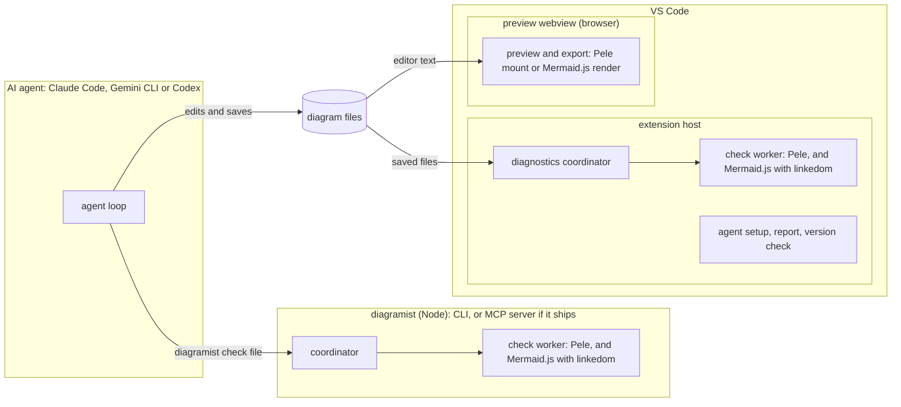

# Diagramist

*   **Author:** Beshoy Sabri
*   **Status:** Approved for implementation. Revised on 2026-11-13 after `egm-review`; the author
    accepted all 30 proposed fixes.
*   **Date:** 2026-11-11 (first draft); 2026-11-13 (revised)
*   **Input:** [concepts_brief.md](../egm/concepts_brief.md), including its "Decisions after the
    review"
*   **Review record:** [consolidated_review_report.md](../egm/review/consolidated_review_report.md)
    and [goldfish_review_report.md](../egm/review/goldfish_review_report.md)

--------------------------------------------------------------------------------

## Overview

Diagramist helps AI coding agents write Mermaid diagrams that parse and draw correctly. It also lets
the person preview and export those diagrams in VS Code.

Two renderers are involved:

*   **Mermaid.js** (https://mermaid.js.org) is the reference implementation of the Mermaid diagram
    language. GitHub, Notion and many documentation sites draw diagrams with it, each at its own
    version.
*   **Pele** (https://pele.run) is a separate implementation of the Mermaid language, made by
    Obsidian. It parses Mermaid text and draws it with its own layout. It needs no browser and is
    themed with CSS variables.

Diagramist has three parts that share one core:

1.  **Checker.** `diagramist` is an npm package. Agents run it from their terminal as
    `diagramist check <file>`. It may also run as an MCP server, `diagramist mcp`, if the evaluation in
    phase P3 shows that this helps. MCP, the Model Context Protocol, is the standard way coding agents
    call outside tools.

    Given a file, the checker finds every Mermaid diagram and runs both renderers on each one.
    Mermaid.js parses the diagram, which checks syntax but not layout, and Pele draws it. For each
    diagram the checker reports whether Mermaid.js parses it and whether Pele draws it. If not, it
    gives the first error, with its line and column in the file when the renderer provides one. It
    needs no VS Code, network connection, account or AI model.
2.  **VS Code extension.** It does four things:
    *   previews diagrams with either renderer;
    *   shows the checker's errors for saved files in the Problems panel;
    *   exports SVG and PNG for slides and documents;
    *   helps connect Claude Code, Gemini CLI and Codex.
3.  **Core.** Shared code with no dependency on VS Code, Node or a browser page. It covers finding
    diagrams in files, mapping positions, checking with each renderer, the result format and the
    fixed render settings.

**What a pass means.** A pass means Mermaid.js 12.3.0 can parse the diagram. For diagrams that target
Pele, it also means Pele 1.13.0 can draw it. GitHub, Notion and documentation sites may run other
Mermaid.js versions, and Mermaid.js can still fail while drawing a diagram it parsed. So a pass is
strong evidence, not a guarantee.

Diagramist calls no AI model. The person's agent writes the diagrams; Diagramist checks, shows and
exports them.

## The Problem (Problem Statement)

People ask AI coding agents (Claude Code, Gemini CLI, Codex) to draw diagrams as Mermaid text:
architecture sketches in READMEs, flows in documentation, figures for slides. Three things go wrong.

1.  **Agents can't see whether a diagram works.** They write Mermaid from memory, and small slips are
    frequent: an unclosed bracket, a reserved word, or a diagram type the destination doesn't
    support. The agent reports the work as done, and the person finds the problem later:
    *   GitHub shows a render error after a push;
    *   Notion shows raw code;
    *   an exported slide image comes out broken.
2.  **Fixing is manual.** The person copies errors from a preview or an online editor back into the
    agent's chat, often several times. Online checkers send the diagram to a website, which some
    workplaces don't allow.
3.  **Renderers disagree.** GitHub, Notion and documentation sites draw with Mermaid.js, each at its
    own version. Pele lays diagrams out differently, and it accepts or rejects some input
    differently. In a test on 2026-11-11, a Sankey value of `abc` passed Mermaid.js and failed Pele.
    A single "valid" verdict hides this.

**What exists today.** Checked on 2026-11-11, from registry listings:

*   **Preview extensions:** the official Mermaid Chart extension (Mermaid.js, about 1.18 million
    installs) and three Pele-based previews (`pdanpdan.mermaid-pele-preview`,
    `bumkom.markdown-viewer-lite`, `saeris.markdown-mermaid-pele`, with 42-130 installs each). Their
    Marketplace listings mention no check that agents can call.
*   **Command-line tools and MCP servers:**
    *   two Pele CLIs on npm (`@ahmedelgabri/pele-cli`, `@simhozebs/pele-cli`);
    *   four Mermaid MCP servers (`@zombie-mermaid/mcp`, `@peng-shawn/mermaid-mcp-server`,
        `mermaid-mcp-server`, `mermaid-mcp-app`).

    Each npm description names one renderer. None mentions mapping errors to positions in the file,
    or editor integration.

## Goals

1.  **Agents check a file by path, without VS Code.** One command, `diagramist check <file>` (or one
    MCP call, if the MCP server ships), checks every Mermaid diagram in a file with VS Code closed.
    For each diagram and renderer, the result says pass, or gives the first error with:
    *   the renderer and its version;
    *   the error class and code;
    *   the file line and column, when available;
    *   a snippet, marked as untrusted text;
    *   a hint.

    *Measure:* a passing file's text result is one line under 200 characters. A failing file's text
    result is capped at 4,000 characters. The P3 agent evaluation records how many tokens each
    agent's model actually sees.
2.  **Two renderers, with Mermaid.js deciding by default.** Both renderers run on every diagram. By
    default only Mermaid.js failures are errors, and Pele failures are warnings. A comment line in
    the diagram can change that: `targets=mermaid,pele` (both must pass), `targets=pele`, or
    `targets=none`. Pele's verdict also becomes binding when the user exports with Pele.

    *Measure:* corpus tests cover every `targets` value.
3.  **Tested with four agents.** Claude Code, Gemini CLI, Antigravity CLI (added 2026-11-14) and
    Codex can check and fix diagrams with Diagramist when run from a terminal, including VS Code's
    integrated terminal.

    *Measures:*
    *   Connecting one agent takes one VS Code command ("Diagramist: Connect AI Agent"). Without VS
        Code, it takes the documented install line plus at most one registration line.
    *   On a fixed set of 30 diagrams with planted errors, the share fixed within three checks is
        recorded per agent, agent version and model. The target is 90%.
4.  **Live preview in VS Code.** `.mmd`, `.mermaid`, `.md` and `.markdown` files preview with either
    renderer.
    *   **Colours:** Pele drawings use VS Code's theme colours. Mermaid.js drawings use Mermaid's own
        `default` or `dark` theme, matched to VS Code's light or dark theme, so they look the way
        GitHub draws them.
    *   **Behaviour:** the preview redraws after a 150 ms pause in typing, keeps the diagram's source
        direction (for example `LR`), and never takes focus.

    *Measure:* for diagrams up to 100 nodes, a Pele drawing appears within 300 ms after the pause and
    a Mermaid.js drawing within 1 second. The P5 webview tests measure this.
5.  **The same verdict in the editor.** For saved files, the Problems panel shows the checker's
    errors, labelled by renderer, at the same file positions the agent gets. This holds whenever the
    extension and the global checker have the same version.

    *Measure:* a P4 test runs the CLI and the diagnostics on the same fixture files and compares codes
    and positions.
6.  **Export for slides and documents.** SVG or PNG, with a chosen renderer, theme (light, dark, or VS
    Code's current kind) and PNG scale.
    *   Exported files carry literal colour values instead of CSS variables, and name a common system
        font stack.
    *   PNG files are drawn with the fonts they were measured with, so labels fit. An SVG file opened
        on another machine may substitute a different font.

    *Measure:* P6 tests check the PNG pixel size (natural size × scale), and that SVG files contain no
    `var(--pele` and no remote references.
7.  **Local and private at run time.** At run time, no part of Diagramist makes network requests or
    calls an AI model.
    *   The one network step is the optional `npm install -g diagramist@<version>`, which "Diagramist:
        Connect AI Agent" shows and the user confirms.
    *   Mermaid.js and Pele are bundled at pinned versions.
    *   Images in diagrams are never loaded.

    *Measure:* the Node and webview test suites fail on any attempted outbound connection.
8.  **Feature-based code on a shared core.** Features never import each other; entry files combine
    them. The core does not depend on VS Code, Node or a browser page.

    *Measure:* `npm run lint:deps` passes in CI.

## Non-Goals

These are for v1.

*   **Writing diagrams.** There is no prompt box and no AI call. The user's agent writes; Diagramist
    checks, shows and exports.
*   **Matching each site's Mermaid.js version.** Diagramist pins one Mermaid.js version and names it in
    every result. It warns about beta and newer diagram types (D4), but cannot know which version a
    site runs.
*   **Checking Mermaid.js layout.** The checker parses with Mermaid.js but does not lay the diagram
    out. Errors that Mermaid.js raises only while drawing are not caught (see Risks & Limits, R1).
*   **Drawing with Mermaid.js outside VS Code.** Mermaid.js needs a browser to draw. Mermaid.js
    drawings and exports come from VS Code's preview panel.
*   **Images for agents.** Results are text.
*   **Math, icon packs, a syntax-highlighting grammar, auto-completion, and Obsidian internal links.**
    Labels with `$$…$$` show the TeX source, icon references are not drawn, and links to Obsidian
    notes do nothing.
*   **VS Code for the Web** (vscode.dev, github.dev).
*   **Other diagram languages,** such as PlantUML, D2 and Graphviz.
*   **A local web server, routing between VS Code windows, or agents controlling the preview.**
*   **Changing agents' settings, instruction files or skill folders without asking.**
*   **Telemetry or any backend** (D6).

## Open Questions

None blocks implementation. The unknowns that remain are listed under
[Risks & Limits](#risks--limits), each with the decision it affects.

*   **Gemini CLI or Antigravity CLI: resolved 2026-11-14.**
    *   **The finding:** since 2026-06-18, Gemini CLI is for Gemini Code Assist Standard and
        Enterprise; free and Google AI Pro or Ultra accounts moved to Antigravity CLI (`agy`)
        ([Gemini CLI README](https://github.com/google-gemini/gemini-cli)).
    *   **The owner's decision:** support both, for enterprise and personal users. Antigravity CLI
        becomes the fourth agent in Goal 3, D8, the evaluation and `docs/agents.md`.

## Critical User Journeys (CUJs)

### CUJ 1: Claude Code fixes a README diagram

*   **Given**: The Diagramist extension and the global checker are installed, and Claude Code has the
    Diagramist skill. The README's diagrams use the default targets, so Mermaid.js must parse them.
*   **When**: The user asks Claude Code to add an architecture diagram to `README.md`.
*   **Then**:
    *   Claude Code writes the fence and runs `diagramist check README.md` (or the MCP tool).
    *   The result reports `README.md:42:15: error [Mermaid.js parse] Expecting "]", got end of line`,
        with the untrusted snippet and a hint.
    *   Claude Code fixes the line, checks again, and gets "0 errors".
    *   Once the file is saved, the preview shows the diagram and the Problems panel has no
        Diagramist entries.

### CUJ 2: Gemini CLI checks a diagram with VS Code closed

*   **Given**: Gemini CLI runs in a terminal, `diagramist` is installed globally, and VS Code is not
    running.
*   **When**: The user asks Gemini to draw a sequence diagram in `docs/login.mmd`.
*   **Then**: Gemini checks the file by path and fixes it until it passes. If the same error comes
    back three times, it stops and asks the user. No network request is made.

### CUJ 3: Codex or CI runs the command-line check

*   **Given**: A repository has diagrams in `docs/`.
*   **When**: Codex runs `diagramist check docs/`, or a pre-commit hook runs it on the changed files.
*   **Then**: The output follows the grammar in Technical Plan section 4. The exit code is 1 when any
    diagram has an error, 2 when a file can't be checked, and 0 otherwise.

### CUJ 4: Exporting a diagram for a slide

*   **Given**: A diagram previews correctly.
*   **When**: The user runs "Diagramist: Export Diagram…" and picks Pele, the light theme, and PNG at
    3×.
*   **Then**:
    *   Diagramist redraws the diagram off-screen with Pele in the light theme, and writes a PNG at
        three times its natural size, with literal colours.
    *   Pasted into Google Slides, it shows the same drawing as the light-theme preview.
    *   If Pele reports an error for this diagram, the export stops, shows the error, and offers
        Mermaid.js instead.

### CUJ 5: The renderers disagree

*   **Given**: A Sankey diagram has a value written as `abc`, and uses the default targets.
*   **When**: The diagram is checked.
*   **Then**:
    *   Mermaid.js parses it, and Pele's syntax error is reported as a warning. The exit code is 0.
    *   The hint says to change the diagram for Pele only if it will be exported with Pele.

### CUJ 6: A diagram from a cloned repository points at a remote image

*   **Given**: A cloned repository has a diagram with an `https` image.
*   **When**: The user opens the preview.
*   **Then**: The image is not shown, and no network request is made.

### CUJ 7: Connecting an agent

*   **Given**: The Diagramist extension and Codex are installed.
*   **When**: The user runs "Diagramist: Connect AI Agent" and picks Codex.
*   **Then**:
    *   Diagramist checks that `diagramist` is on the PATH, and offers the install command if it isn't.
    *   After the user agrees, it copies the skill to `~/.agents/skills/diagramist/`.
    *   If the MCP server ships, it runs `codex mcp add diagramist -- diagramist mcp` in a visible
        terminal, again after the user agrees.
    *   "Diagramist: Check Agent Setup" then reports the checker version and the skill copy.

## Technical Plan (Proposed Architecture)

### 1. Parts and where they run



*Checked on 2026-11-13 with Pele 1.13.0 and Mermaid.js 12.3.0: both accept this diagram.*

Code runs in four kinds of place:

*   **The checker process.** Agents start it; it never contacts VS Code.
*   **VS Code's extension host.** It runs diagnostics, agent setup and the version check.
*   **The preview webview.** A browser page that draws with Pele or Mermaid.js and produces exports.
*   **A check worker thread** inside each Node process that checks diagrams. It runs Pele and
    Mermaid.js. Mermaid.js needs a browser in Node, so the worker first installs linkedom, a small
    library that imitates one.

One worker runs both renderers. Pele gets an explicit text measurer through its public `measurer`
option (width = characters × font size × 0.6), so it never looks for a canvas in the stand-in. P2
chose linkedom from three candidates and measured this layout against one worker per renderer: it
saves 10 to 16 MB and one start-up, and costs about 1 ms per diagram
([packaging notes](packaging-notes.md)).

The agent and VS Code never talk to each other. They meet only through files: the agent edits and
saves a file; the extension checks saved files and previews the editor text.

### 2. Modules

The **core** (`src/core/`) has no dependency on VS Code, Node or a browser page. It is type-checked
without the DOM library and without Node types.

| Module | Job |
| --- | --- |
| `blocks` | Finds diagrams. A `.mmd` or `.mermaid` file is one diagram. In `.md` and `.markdown` files, markdown-it finds fences whose info string starts with `mermaid` (case-insensitive), following CommonMark rules for nesting, indentation and unclosed fences. For each diagram line, it records how many UTF-16 code units the container stripped (list indentation, `>` quote markers, fence indentation). |
| `positions` | Turns a renderer position into a file position: 1-based line and column, with columns in UTF-16 code units. It also keeps the diagram-relative line and column. |
| `renderers/mermaid/check` | The only core code that imports `mermaid`. It checks with `mermaid.parse()`, which is asynchronous, and maps errors (section 4). It relies on a browser-like global environment that its host provides. |
| `renderers/pele/check` | The only core code that imports `pele`. It checks with `render()` using the fixed policy, and maps `PeleError`. |
| `result` | The result format, version 1 (section 4): building results, and printing them as text and JSON. |
| `policy` | Fixed render settings: Pele `images: false`, `autoDirection: false`, `responsive: false` and a fixed `now` of 2000-01-01T00:00:00Z for checks; Mermaid.js `securityLevel: "strict"`; the limits in [Risks & Limits](#risks--limits). |
| `hints` | One-line hints per class and code, "did you mean" suggestions, and the one-line-late hint. |
| `targets` | Reads `%% diagramist: targets=…` (D3). |
| `compat` | The list of known diagram keywords, each flagged `beta` or `external`, plus the beta and newer-type notices (D4). |
| `samples` | One minimal valid diagram for each keyword in `compat`. |

**Shared layers outside the core:**

| Layer | Contents |
| --- | --- |
| `src/draw/` (browser only) | `pele-draw.ts` (Pele `mount`, with its own error display), `mermaid-draw.ts` (`mermaid.render`) and `theme-map.ts`. Only webview code imports this layer. |
| `src/platform/node/` | The coordinator, the worker pool, worker message types, file reading, the browser stand-in (`dom-standin.ts`, linkedom) and the stderr logger. |
| `src/platform/vscode/` | The log channel, settings, Workspace Trust and the in-memory counts. |
| `src/platform/messages.ts` | Type-only definitions of the messages between the extension host and the webview. |

### 3. Execution model

One coordinator, in `src/platform/node/coordinator.ts`, serves both the checker process and the
extension host.

*   **API:**
    *   `checkFile(path, options): Promise<CheckResult>`;
    *   `checkText(text, options): Promise<CheckResult>`, for exactly one diagram.
*   **Steps:**
    1.  Resolve and validate the path (section 6).
    2.  Read the file and find blocks.
    3.  Resolve each block's targets.
    4.  Send the block to the check worker, which checks it with Pele and then Mermaid.js.
    5.  Merge both verdicts into a `BlockResult`.

    Blocks of one file are checked in order.
*   **Starting the worker:**
    *   The check worker starts on the first diagram the process sees. It installs the stand-in,
        loads both renderers and posts `ready`. That took 0.2 to 0.6 s in P2.
    *   The start-up budget is 20,000 ms. If a worker misses it, the worker is stopped, the block gets
        class `tool` and code `start-timeout`, and the next request starts a fresh worker.
*   **Time limit per block:** 2,000 ms for both renderers, counted from when a ready worker receives
    the block. On timeout, the worker is stopped. A renderer that already posted its verdict keeps
    it; the other gets `tool` / `timeout`. Requests still queued for that worker go to a fresh worker;
    they are not failed.
*   **Crashes:** if a worker exits or throws, the block gets `tool` / `crash`, and the worker restarts.
*   **Messages**, defined in `src/platform/node/worker-messages.ts`:
    *   to a worker: `{ type: "check", id, text }`;
    *   from the worker: `{ type: "ready", versions: { mermaid, pele } }`, one
        `{ type: "result", id, renderer, verdict }` per renderer, and `{ type: "log", level, message }`.
*   **Queues:**
    *   The CLI and the MCP server keep a first-in, first-out queue and never drop a request.
    *   The extension's diagnostics keep at most 8 queued requests per window. A newer request for
        the same file replaces an older one that hasn't started; the replaced request ends as
        `superseded`, which is internal and never shown.
*   **Exit codes for `diagramist check`:**
    *   2 if any file had a tool or input problem;
    *   otherwise 1 if any diagram had an error;
    *   otherwise 0. Warnings and notices never change the exit code.

### 4. Result format, version 1 (normative)

This section is the single definition. Other sections refer to it. Within version 1, fields are only
ever added.

```text
CheckResult
  schemaVersion: 1
  checker:   "diagramist <version>"
  renderers: { mermaid: "<version>", pele: "<version>" }
  file:      absolute path, or null for text input
  status:    "checked" | "no-diagrams" | "not-found" | "not-a-file" | "unsupported-file"
             | "too-large" | "not-text" | "bad-input"
  message:   null when status is "checked" or "no-diagrams"; otherwise one line
  blocks:    BlockResult[]      -- empty unless status is "checked"
  summary:   { blocks, errors, warnings, notices }

BlockResult
  index:       1-based
  firstLine:   file line of the diagram's first line (after the opening fence); 1 for text input
  lastLine:    file line of the diagram's last line
  type:        the diagram type from mermaid.parse(), else Pele's mermaidType, else null
  targets:     subset of ["mermaid", "pele"]; empty for targets=none
  targetsFrom: { source: "default" } | { source: "comment", line }
  results:     { mermaid: RendererResult, pele: RendererResult }
  notices:     Notice[]

RendererResult
  outcome: "pass" | "fail" | "tool-error"
  depth:   "parse" (Mermaid.js) | "render" (Pele)
  errors:  Problem[]            -- empty on pass; at most one entry in v1

Problem
  severity:   "error" if the renderer is a target, or the class is "tool"; otherwise "warning"
  class:      "invalid" | "unsupported" | "too-large" | "tool"
  code:       from the code lists below
  message:    one line, at most 200 characters, untrusted
  position:   { line, column, diagramLine, diagramColumn } | null    -- 1-based, UTF-16 columns
  anchorLine: file line used when position is null (equals firstLine)
  snippet:    at most 200 characters: the line before and the reported line, untrusted; or null
  hint:       one line, or null
  retry:      true only for class "invalid"

Notice
  code:    "beta-type" | "newer-type" | "bad-targets-comment" | "fences-stripped"
  message: one line
```

**Code lists:**

*   **Pele:** Pele's own codes, passed through: `syntax`, `semantic`, `limit`,
    `unsupported-diagram`.
*   **Mermaid.js:** Mermaid.js has no error codes, so Diagramist defines these:
    *   `parse`, for a grammar error;
    *   `unknown-type`, for "No diagram type detected";
    *   `limit`, when the source is over 50,000 characters (Diagramist checks this before parsing);
    *   `other`, for any other exception.
*   **Tool:** `timeout`, `start-timeout`, `crash`, `internal`.

**Classes:**

*   **`invalid`:**
    *   Pele `syntax` and `semantic`; Mermaid.js `parse` and `other`;
    *   `unknown-type` and `unsupported-diagram` when the first keyword is unknown (a "did you mean"
        hint is added).
*   **`unsupported`:**
    *   the first keyword is a known external type, such as `zenuml`;
    *   or Pele says `unsupported-diagram` for a type Mermaid.js parsed; this also adds the
        `newer-type` notice.
*   **`too-large`:** the `limit` codes.
*   **`tool`:** the tool codes.

**Mapping Mermaid.js errors:**

*   **Jison grammar errors** carry `hash.loc`. The position is `last_line`, with column
    `last_column + 1`, because Mermaid's columns count from 0. This was checked on 2026-11-11: for the
    same error Mermaid.js gave line 3, column 3, and Pele gave line 3, column 4.
*   **The message** is the line of `error.message` that starts with "Expecting", or else the first
    line. Grammar token names are translated, for example `SQE` → `"]"`, `PE` → `")"`, `NEWLINE` →
    "end of line", `EOF` and `$end` → "end of diagram". The expected list is cut to five tokens plus
    "…".
*   **Langium-based types** (architecture, gitGraph, info, packet, pie, radar, treemap and the others
    that `@mermaid-js/parser` handles) throw errors without `hash`. Phase P1 records each error
    shape's fields with a corpus case. A 1-based line and column are used when the error provides
    them; otherwise `position` is null.

**Text form.** The CLI and the MCP tool both print this:

```text
header:  <file>: <n> diagram(s), <e> error(s), <w> warning(s) [Mermaid.js <ver> parse, Pele <ver> render]
problem: <file>:<line>:<column>: <severity> [<Renderer> <code>] <message>
         <file>:<anchorLine>: <severity> [<Renderer> <code>] <message> (no position; the diagram starts here)
snippet:   diagram text (untrusted):
           <line-1> | <text>
           <line> | <text>
hint:      hint: <hint>
notice:  <file>:<firstLine>: notice [<code>] <message>
pass:    <file>:<firstLine>: ok (<type>): Mermaid.js parses, Pele renders     (only with --verbose)
cap:     … <k> more problem(s) not shown (output capped at 4,000 characters)
summary: <f> file(s), <b> diagram(s), <e> error(s), <w> warning(s)          (CLI, last line)
```

Renderer names are written "Mermaid.js" and "Pele" in text, and `mermaid` and `pele` in JSON keys and
comments. A passing file prints only its header line. The cap applies to each file's text. Most
models use roughly four characters per token, so the cap is about 1,000 tokens; the P3 evaluation
records the real counts.

Example:

```text
README.md: 2 diagrams, 1 error, 0 warnings [Mermaid.js 12.3.0 parse, Pele 1.13.0 render]
README.md:42:15: error [Mermaid.js parse] Expecting "]", got end of line
  diagram text (untrusted):
  41 |   A[Client] --> B[API
  42 |   B --> C[(DB)]
  hint: the "[" opened on line 41 is not closed; errors are often reported one line late.
```

### 5. Agent interface

**The CLI**, `packages/diagramist`:

*   `diagramist check <paths…> [--json] [--verbose]`
    *   It checks files and folders. In folders it takes `.md`, `.markdown`, `.mmd` and `.mermaid` files
        and skips `node_modules` and hidden folders.
    *   `--json` prints one `CheckResult` per line, as JSON.
    *   It uses the exit codes in section 3.
*   `diagramist mcp` starts the MCP server over stdio.
*   `diagramist --self-test` checks every sample with both renderers. It exits 0 when every result
    matches the samples' expected results, and 2 otherwise.
*   `diagramist --version` and `diagramist --help`.

**The MCP server** ships in v1 only under the rule in D7.

*   **Tool:** one tool, `check`, with inputs `path` or `text`.
    *   `path` is resolved against the server's working directory. `text` is one diagram, with
        positions counted from its first line.
    *   Passing both, or neither, gives status `bad-input`.
*   **Output:** text content only, the text form from section 4, with no `outputSchema`. `isError` is
    true only for a status other than `checked` or `no-diagrams`, or for any tool error.
*   **Annotations:** `readOnlyHint: true`, `idempotentHint: true`, `openWorldHint: false`.
*   **Description:** at most 80 words; a test counts them. Draft: "Check Mermaid diagrams in a file
    with Mermaid.js and Pele. Call it after writing or editing any Mermaid diagram, and fix errors
    until it passes. Results give the first error per renderer with its file line. Don't rewrite a
    diagram for 'unsupported' or 'too-large' errors, or for warnings. After three failures on the
    same error, stop and ask the user."

**The skill.** One `skills/diagramist/SKILL.md` (D8) teaches agents:

*   when and how to check;
*   how to read results;
*   the `targets` comment;
*   the stop-after-three rule;
*   short tips per diagram type.

### 6. Security and privacy

*   **No network at run time.**
    *   The webview's Content Security Policy is `default-src 'none'; script-src 'nonce-<nonce>';
        style-src <webview.cspSource> 'unsafe-inline'; img-src <webview.cspSource> data:`.
    *   Inline styles are allowed because both renderers put styles inside their SVG. The remaining
        risk is CSS injection from diagram text, with no script execution.
    *   Command links are off.
*   **Images are never loaded.** Pele runs with `images: false`. Mermaid.js images are blocked by the
    policy above, and nothing is shown in their place.
*   **Links** open only through VS Code, after the user confirms. Obsidian-style internal links do
    nothing.
*   **File reading:**
    *   The checker accepts only regular files ending in `.md`, `.markdown`, `.mmd` or `.mermaid`
        (case-insensitive), after resolving the real path. Anything else gets status
        `unsupported-file` or `not-a-file`, and its content is not read.
    *   Files must be at most 1 MB and valid UTF-8; a byte-order mark is removed.
*   **Untrusted text.** Snippets and messages carry diagram text, which may come from a cloned
    repository. The text form labels them "diagram text (untrusted)". Logs include them only at
    trace level.
*   **Exports** remove any remote `href` from SVG files.
*   **Restricted Mode** (an untrusted folder): the preview and diagnostics stay on; agent setup is off.
    Images and links are already off everywhere.
*   **Agents' files.** Diagramist changes agents' settings and skill folders only through the agents'
    own commands, or a visible file copy, after the user agrees.

### 7. Observability

*   **Versions everywhere.** Results, the diagnostic report and the log session header name the
    Diagramist, Mermaid.js and Pele versions.
*   **Logs.** The extension writes to one VS Code log channel, "Diagramist", which follows VS Code's
    log level. The checker logs to stderr, because MCP owns stdout. Its level comes from the
    `DIAGRAMIST_LOG` environment variable (`error`, `warn`, `info`, `debug` or `trace`; the default is
    `warn`).
*   **Self-test.** `diagramist --self-test` is for troubleshooting. CI runs the same samples.
*   **The diagnostic report.** "Diagramist: Copy Diagnostic Report" copies a Markdown report to the
    clipboard. It has five parts:
    *   versions (extension, the checker found on the PATH, Mermaid.js, Pele, VS Code);
    *   environment (OS, remote kind, UI kind);
    *   the two settings;
    *   agent setup status;
    *   this window's counts.

    It leaves out file paths, workspace names and diagram text. A quick pick lets the user include
    paths.

### 8. Code layout (feature-based)

```text
skills/diagramist/SKILL.md
src/
  entries/          cli.ts, extension.ts, webview.ts, check-worker.ts
  core/             blocks, positions, renderers/{mermaid,pele}/check, result, policy, hints,
                    targets, compat, samples
  draw/             pele-draw.ts, mermaid-draw.ts, theme-map.ts          (browser only)
  platform/
    node/           coordinator, worker-pool, worker-messages, read-file, dom-standin, logger
    vscode/         log, settings, trust, counts
    messages.ts     host <-> webview message types (types only)
  features/
    checker/        cli.ts, mcp-server.ts, tool-description.ts, self-test.ts      (Node)
    diagnostics/    diagnostics.ts                                            (extension host)
    preview/        host/{panel,html,export-command}.ts, webview/{main,export}.ts
    agent-setup/    agents.ts, connect.ts, check-setup.ts, disconnect.ts, version-check.ts,
                    report.ts                                                 (extension host)
```

**Import rules,** checked by dependency-cruiser in CI:

*   **Core:** `core/**` imports only `core/**`. Only `core/renderers/mermaid/**` imports `mermaid`, only
    `core/renderers/pele/**` imports `pele`, and only `core/blocks/**` imports `markdown-it`.
*   **Draw layer:** `draw/**` imports `core/**`, and `mermaid` or `pele` only in its own draw file. Only
    `features/preview/webview/**` and `entries/webview.ts` import `draw/**`.
*   **Platform:**
    *   `platform/node/**` imports `core/**` and Node built-ins, and never `vscode` or
        `platform/vscode/**`. Only `platform/node/dom-standin.ts` imports `linkedom`.
    *   `platform/vscode/**` may import `vscode` and `core/**`.
    *   `platform/messages.ts` has no runtime imports.
*   **Features:** they never import each other.
    *   `features/checker/**` never imports `vscode` or `platform/vscode/**`.
    *   `features/*/webview/**` never imports `vscode`, `platform/node/**` or `platform/vscode/**`.
*   **Entries:** only `entries/**` may import more than one feature.

**Type checking:**

*   `tsconfig.core.json` covers `src/core/**` with `lib: ["ES2022"]`, no `types`, and
    `skipLibCheck: true`, because the renderers' type files mention DOM types. Core code can't create
    DOM values, so it can't call `mount()`.
*   `tsconfig.webview.json` adds the DOM library for `src/draw/**`, `src/features/preview/webview/**`
    and `src/entries/webview.ts`.
*   `tsconfig.node.json` covers the rest.

### 9. Choices with one defensible answer

*   **Build.** TypeScript 6.0.3 in strict mode, used only for type checking. P1 found that TypeScript 7's
    npm package no longer exposes the JavaScript API that dependency-cruiser needs. esbuild 0.28 builds
    the bundles:
    *   `extension.cjs` (CommonJS, `vscode` external);
    *   `webview.js` (an IIFE for the browser);
    *   `cli.mjs` and `check-worker.mjs` (ES modules for Node).
*   **Node 22.12 or later at run time.** Mermaid.js 12.3.0 declares `node >=22.12.0`; Pele only needs
    `>=20` and linkedom `>=16`. Development also needs Node 22, because Vitest 5 and dependency-cruiser
    18 require it. The extension host must meet the same minimum: VS Code 1.101 (Electron 35.5.1,
    Node 22.15.1) is the oldest that does, so `engines.vscode` is `^1.101.0`. P2 ran the bundled check
    worker on Node 22.12.0 and 22.15.1. Checked on 2026-11-13.
*   **Pinned versions.** `mermaid` 12.3.0, `pele` 1.13.0, `markdown-it` 15.0.3 and `linkedom` 0.18.15 are
    pinned exactly.
*   **Upgrade policy.** An upgrade that changes any verdict is at least a minor release, with a
    "Validator changes" changelog entry. A major version of either renderer means a Diagramist major
    version.
*   **Prefix.** Settings, commands, the MCP server name and the log channel all use `diagramist`.
*   **No default keybinding.** The preview command is in the editor title bar and the command palette.
    That avoids clashes with existing shortcuts, such as Markdown's Ctrl+K V and Ctrl+K D.

### 10. Decisions

| # | Decision (as revised 2026-11-13) |
| --- | --- |
| D1 | Agents run the checker from the npm package `diagramist`, installed globally. The extension checks the installed version when it activates. |
| D2 | Diagramist's own preview panel. |
| D3 | Mermaid.js is the default must-pass renderer. Both renderers always run. A comment opts a diagram into Pele, or out of both. |
| D4 | The newest Mermaid.js is pinned. Only beta and newer-type notices ship; the version table is deferred. |
| D5 | Export from the preview panel only. |
| D6 | No telemetry. The extension keeps in-memory counts for the diagnostic report. |
| D7 | The CLI ships. Whether the MCP server ships in v1 is decided by the P3 agent evaluation. |
| D8 | A short tool description plus one `SKILL.md`, copied into each agent's own skills folder. |

#### D1: agents run the checker from a global npm install

*Decided 2026-11-11 (options: an npm package; a launcher inside the extension; both). The author took
the npm package.*

*   **Install.** `npm install -g diagramist` installs the command `diagramist`. Agents run `diagramist
    check` or `diagramist mcp`, not `npx`, which keeps npm's own process running beside the checker:
    about 96 MB more per session, measured on 2026-11-11.
*   **Version check.** When the extension activates, it runs `diagramist --version` once, with a 5 s
    limit. If the version differs from the extension's, it shows a non-blocking notice with a "Copy
    update command" button (`npm install -g diagramist@<extension version>`). If the command is
    missing, the notice appears only after an agent has been connected in this profile.
*   **Failure cases.** These are covered under Risks & Limits (R3, R4): no Node, no access to npm for
    the one-time install, Windows `.cmd` shims, Node version managers, and EACCES.

#### D2: one Diagramist preview panel

*Decided 2026-11-11 (options: own panel; VS Code's built-in Markdown preview; both).*

*   **Opening.** "Diagramist: Open Preview to the Side" is a button in the editor title bar for `.mmd`,
    `.mermaid`, `.md` and `.markdown` files.
*   **What it shows.** It follows the active editor, unless locked with "Diagramist: Toggle Preview
    Lock". It shows every diagram in the file in order, and scrolls to the one at the cursor.
*   **Renderer and theme.** A switch chooses Pele or Mermaid.js; the default comes from
    `diagramist.preview.defaultRenderer`. Theme handling follows Goal 4.
*   **Status line.** It shows the file, the diagram, the renderer and its version, and the time of the
    last update. When the editor has unsaved changes, it adds "unsaved changes: agents and the Problems
    panel check the saved file".
*   **Errors.** A diagram with an error keeps its last good drawing, dimmed, under the error, which is
    shown as text and announced to screen readers. Pele drawings use `mount()`'s own error display.
*   **Accessibility.** Diagrams can be reached with Tab. Errors use text as well as colour.
    `accTitle` and `accDescr` are kept.
*   **Restore.** After a reload, the panel reopens on the same file and diagram.

#### D3: Mermaid.js decides by default; a comment opts into Pele

*Decided 2026-11-11 as "both by default". Changed by the author on 2026-11-13, by accepting the review
fix CA-01.*

*   **Defaults.** Both renderers run on every diagram. Default targets are `mermaid`.
*   **The comment.** `%% diagramist: targets=mermaid,pele`, `targets=pele` or `targets=none` sets them.
    It goes on the diagram's first line, or the line directly after the type line. Both positions were
    tested on 2026-11-11; it is not supported inside Mermaid frontmatter.
*   **Bad comments.** Unknown values keep the default and add a `bad-targets-comment` notice.
*   **Export.** Exporting with Pele refuses a diagram that Pele can't draw, and offers Mermaid.js.

#### D4: the newest Mermaid.js, with beta and newer-type notices

*Decided 2026-11-11 as "newest version plus a version table". Changed by the author on 2026-11-13, by
accepting the review fix CA-15.*

*   **Pin.** Mermaid.js 12.3.0, pinned exactly.
*   **Notices.**
    *   `beta-type`: the diagram's keyword ends in `-beta`.
    *   `newer-type`: Mermaid.js parses the diagram but Pele reports `unsupported-diagram`. Pele
        supports every type built into Mermaid 12.1.0, so this marks a type newer than 12.1, which
        older Mermaid versions on some sites may not draw.
*   **Deferred.** The version table, the oldest-version setting, the flag and the tool input are listed
    under Future Improvements.

#### D5: export from the preview panel only

*Decided 2026-11-11.* The details are in the plan's phase P6.

*   **Off-screen redraw.** Export redraws the chosen diagram off-screen with the chosen renderer and
    theme, at natural size. Pele uses `responsive: false`; Mermaid.js uses `htmlLabels: false`.
*   **SVG.** Colours are written into the file as literal values.
*   **PNG.** It is drawn on a canvas at the chosen scale, up to a limit (see Risks & Limits).
*   **Panel.** If no panel is open, the command opens one for the active editor first.

#### D6: no telemetry

*Decided 2026-11-11.* Nothing is sent anywhere.

*   **What is counted.** In memory, for each window: checks run, files with errors, errors by renderer
    and code, and tool errors by code. The diagnostic report includes them.
*   **What is not counted.** The checker keeps no counts, because nothing could read them.

#### D7: the CLI ships; MCP depends on the P3 evaluation

*Decided 2026-11-11 (CLI in v1: yes). Extended by the author on 2026-11-13, by accepting the review fix
CA-06.*

*   **Evaluation.** Phase P3 runs the agent evaluation twice per agent: first with the CLI plus
    `SKILL.md`, then with the MCP server.
*   **The rule.** The MCP server ships in v1 if either of these holds for at least one of the three
    agents:
    *   it raises the share of diagrams fixed within three checks by 10 percentage points or more;
    *   the agent can't run `diagramist check` without a permission prompt on every call, while the
        MCP tool can be pre-approved.

    The outcome is recorded in this document.

#### D8: one shared skill, copied per agent

*Decided 2026-11-11.*

*   **Contents.** `skills/diagramist/SKILL.md` has the frontmatter `name: diagramist`, the description
    "Use when writing or editing Mermaid diagrams: check them with Diagramist and fix errors before
    finishing.", and `metadata.diagramistVersion`. Its body is at most 150 lines.
*   **Where it goes.** "Connect AI Agent" copies it into the chosen agent's own skills folder after
    the user agrees, so no agent shares a folder with another:
    *   `~/.claude/skills/diagramist/` for Claude Code;
    *   `~/.gemini/skills/diagramist/` for Gemini CLI;
    *   `~/.gemini/config/skills/diagramist/` for Antigravity CLI (added 2026-11-14). It also reads
        Gemini CLI's folder and prefers it, so someone with both agents keeps one copy there;
    *   `~/.agents/skills/diagramist/` for Codex.

    The sources are under Additional Resources.

## Alternatives Considered

### Alternative 1: A standalone app with its own web UI

*   **Pros**: works from any browser, including a phone, and needs no VS Code.
*   **Cons**: a server to run and secure, a second place to edit diagrams, and it sits away from the
    editor where agents write files.
*   **Reason for Rejection**: Rejected by author: diagrams live in the same repositories as the code,
    and a separate app means a second editor and a server to secure.

### Alternative 2: The extension calls Gemini CLI, or another agent CLI, to write diagrams

*   **Pros**: a prompt box inside VS Code.
*   **Cons**:
    *   it ties the tool to one agent;
    *   starting an agent for each request takes seconds;
    *   it needs that agent's login on the machine.
*   **Reason for Rejection**: Rejected by author: tying Diagramist to one agent's CLI would exclude the
    others, so Diagramist calls no AI model and any agent can drive it.

### Alternative 3: Pele only

*   **Pros**: one renderer, about 7 MB more memory than a bare Node process, and checks in under a
    millisecond.
*   **Cons**: GitHub, Notion and documentation sites draw with Mermaid.js, so a Pele pass can still
    fail there.
*   **Reason for Rejection**: Rejected by author (2026-11-11), because those sites are the main
    destinations.

### Alternative 4: The names "Pele Renderer", "Pele Diagrams for VS Code", "Diagramsmith" and "Lavagram"

*   **Pros**: the first two say what the tool is built on, and all four were free on the VS Code
    Marketplace, Open VSX and npm (checked 2026-11-11).
*   **Cons**:
    *   The first two read as official Obsidian products, put a third-party name into a permanent ID,
        and describe half the tool once Mermaid.js is added.
    *   "Diagramsmith" is longer and suggests making diagrams rather than checking them.
    *   "Lavagram" relies on a volcano reference to Pele that fits less once Mermaid.js is an equal
        partner.
*   **Reason for Rejection**: Rejected by author, in favour of "Diagramist".

### Alternative 5: Contribute to an existing Pele preview extension

*   **Pros**: less new code and an existing user base.
*   **Cons**: the three candidates are Pele-only previews, with no agent check, Mermaid.js, CLI or
    export. Their listings were checked on 2026-11-11.
*   **Reason for Rejection**: Not adopted. The author approved this section on 2026-11-11 without
    choosing to contribute upstream. Working with those projects later remains possible.

### Alternative 6: Use an existing Pele CLI

*   **Pros**: `@ahmedelgabri/pele-cli` and `@simhozebs/pele-cli` already check or draw with Pele.
*   **Cons**: Pele only; their npm descriptions mention no MCP server, no Markdown position mapping and
    no Mermaid.js.
*   **Reason for Rejection**: Not adopted. Diagramist needs both renderers and positions in the file.

### Alternative 7: Use an existing Mermaid MCP server

*   **Pros**: `@zombie-mermaid/mcp`, `@peng-shawn/mermaid-mcp-server`, `mermaid-mcp-server` and
    `mermaid-mcp-app` can be called by agents today.
*   **Cons**: each names one Mermaid renderer and no Pele. `@peng-shawn/mermaid-mcp-server` converts
    to PNG through a headless browser. None mentions file positions or editor integration.
*   **Reason for Rejection**: Not adopted. They cover neither Pele nor the editor side.

### Alternative 8: Offer the tools through VS Code's own tool APIs

*   **Pros**: no separate program.
*   **Cons**: `vscode.lm.registerTool` and the MCP server provider API reach only VS Code's built-in
    chat (Copilot), not Claude Code, Gemini CLI or Codex.
*   **Reason for Rejection**: Rejected on technical grounds (brief, finding 1). The same server can be
    registered there later.

### Alternative 9: A local web server in the extension, linking agents and the preview

*   **Pros**: agents could drive the preview directly.
*   **Cons**: a port, a token, and protection against web pages calling it; one server per window; it
    disappears when VS Code closes, and fails in remote setups.
*   **Reason for Rejection**: Rejected by author when accepting the brief's reshaped design on
    2026-11-11. Files are a simpler link, and work with VS Code closed.

### Alternative 10: Load the renderers from a CDN

*   **Pros**: a smaller package.
*   **Cons**: it breaks offline use, needs a looser Content Security Policy, and lets the renderer
    change without a release.
*   **Reason for Rejection**: Rejected on technical grounds. It conflicts with Goal 7.

### Alternative 11: Render on the extension host's main thread

*   **Pros**: simpler code.
*   **Cons**: neither renderer has a time limit, so one slow diagram would freeze every extension in
    the window.
*   **Reason for Rejection**: Rejected on technical grounds. Pele's security page recommends a worker
    when a time limit is needed.

### Alternative 12: Check Mermaid.js syntax with `@mermaid-js/parser`, without a browser stand-in

*   **Pros**: no browser stand-in in the check worker.
*   **Cons**: version 2.0.1 parses only 12 types: architecture, cynefin, eventmodeling, gitGraph, info,
    packet, pie, radar, railroad, treemap, treeView and wardley. It does not parse flowchart,
    sequence, class, state, ER, Gantt or other common types (checked on 2026-11-11).
*   **Reason for Rejection**: Rejected on technical grounds. To revisit as that parser grows.

### Alternative 13: Draw with Mermaid.js in the checker through a headless browser

*   **Pros**: Mermaid.js layout errors and Mermaid.js exports without VS Code.
*   **Cons**: a browser download of hundreds of megabytes, seconds to start, and far more memory.
*   **Reason for Rejection**: Rejected on technical grounds for v1. Risk R1 records what this leaves
    uncaught.

### Options passed over in D1-D8

| Decision | Option not taken | Main drawback | Can it be added later? |
| --- | --- | --- | --- |
| D1 | A launcher inside the extension | Needs VS Code installed; no use for CI | Yes |
| D1 | Both the npm package and a launcher | Two install paths and two releases to keep in step | Yes |
| D2 | VS Code's built-in Markdown preview | Two surfaces; VS Code's preview security settings; clashes with other Mermaid extensions | Yes, as an opt-in |
| D2 | Both | All of the above in v1 | Yes |
| D3 | Both renderers must pass by default | False errors for diagrams GitHub accepts (review fix CA-01) | Per diagram, by comment |
| D3 | A project file with folder rules | One more file per repository | Yes |
| D4 | GitHub's Mermaid.js version | GitHub doesn't publish it; manual tracking | No |
| D4 | A version table and oldest-version setting | Hand-made data and three copies of one value (review fix CA-15) | Yes |
| D5 | The checker exports SVG and PNG | About 3 MB more, Pele only, and font-measuring work | Yes |
| D6 | Opt-in telemetry | A collection service, a privacy policy and an exception to Goal 7 | Only by changing Goal 7 |
| D7 | MCP server only | No CI or pre-commit use | No |
| D8 | A package per agent | Three package formats to maintain | Yes |

## Risks & Limits

| # | Risk | Impact | Mitigation | Remaining risk |
| --- | --- | --- | --- | --- |
| R1 | Mermaid.js is only parsed, at one version | A pass can still fail on a site running another version, or while Mermaid.js draws | The wording in section 4; beta and newer-type notices (D4); P1 corpus cases that parse but fail to draw | Draw-time errors and version differences are not caught |
| R2 | The renderers disagree | Pele rejects some diagrams Mermaid.js accepts, and the reverse | Mermaid.js decides by default; Pele failures are warnings until a Pele export (D3) | Pele exports may need edits |
| R3 | Launch failures | `diagramist` not found or not runnable: Windows `.cmd` shims, Node version managers, EACCES, no Node | A Windows `cmd /c` form; `docs/agents.md` covers the version manager and EACCES cases; the version check (D1) | Setups outside the documented cases |
| R4 | Version drift | The extension updates itself; the global checker does not | The version check at activation (D1); every result names its versions | Until the user updates, the editor and the agent may disagree |
| R5 | Memory per agent session | A checker process uses about 55 to 65 MB before its worker starts, 125 to 145 MB once it is ready, 145 to 165 MB after typical diagrams and 195 to 230 MB with every diagram type loaded (P2, Linux and macOS; Windows reports less; [packaging notes](packaging-notes.md)) | linkedom, the lightest stand-in, and one worker for both renderers (P2); the worker starts only on the first diagram; the 256 MB budget in the NFRs | Many parallel sessions multiply the cost |
| R6 | Reading arbitrary files | A pre-approved tool could read files the user didn't intend | Diagram file types only, regular files, real paths; untrusted labels (section 6) | Any diagram file the user's account can read can be checked |
| R7 | One diagram freezes the preview | The webview draws without a time limit | A typing pause; the 50,000-character and 5,000-edge limits; the last good drawing kept | A pathological diagram can stall the preview panel (not VS Code itself) until it is closed |
| R8 | Supply chain | The extension offers `npm install -g diagramist`, so the npm name and its publish token matter | npm has no reservation and forbids placeholder packages, so the first working CLI (0.1.0) is published early in P3, by hand with 2FA; every later release comes only from CI through npm trusted publishing with no stored token, stage-only, so the maintainer approves each one with 2FA; publishing with tokens is disallowed | A compromised npm account |
| R9 | Agents' CLIs change | Commands and skill folders change between agent releases | Use the agents' own commands; re-check before each release (P7, P8); dated sources | Breakage between checks |
| R10 | One maintainer | 2 renderers × 3 agents × 3 operating systems × remote setups | Support tiers in `docs/agents.md`; CI covers the checker on three operating systems | Best-effort combinations may break |

**Limits enforced in code:**

| Limit | Value | Where |
| --- | --- | --- |
| File size | 1 MB | `platform/node/read-file.ts` (status `too-large`) |
| Diagram source | 50,000 characters | Pele's default, also applied before Mermaid.js parsing |
| Edges | 5,000 | Pele's default |
| Time per diagram check | 2,000 ms after the worker is ready | coordinator |
| Worker start-up | 20,000 ms | coordinator |
| Diagnostics queue | 8 per window | coordinator (diagnostics mode) |
| Text output | 4,000 characters per file | `core/result/format-text.ts` |
| PNG export | 16,384 px per side and 100,000,000 px in total | `features/preview/webview/export.ts` |
| Package size | 15 MB packed, for each of the VSIX and the npm tarball | `scripts/check-size.mjs` |

**Unknowns, and the decision each affects:**

*   **U1.** How many tokens of each result each agent's model sees, and whether it reads text or
    structured content. This affects the Goal 1 measure; P3 records it.
*   **U2.** How each agent pre-approves running `diagramist check`, or the MCP `check` tool. This
    affects D7's rule and `docs/agents.md`; P3 and P7 record it.
*   **U3.** Whether Gemini CLI and Codex read the skill folders listed in D8 in their current
    versions. This affects agent setup; P7 verifies it with each agent.
*   **U4.** Which Mermaid.js version GitHub runs. This affects the deferred version table, not v1.

## Non-Functional Requirements

*   **Security and privacy.** Goal 7 and Technical Plan section 6.
*   **Performance and resource use:**
    *   A check of a file with up to 10 diagrams returns within 500 ms with warm workers on a typical
        laptop. CI asserts 1,500 ms and reports the measured time.
    *   The first check also pays worker start-up; it is budgeted at 20 s and took 0.2 to 0.6 s in P2.
    *   **Memory budget (R5):** a checker process with a ready check worker stays under 256 MB resident
        after checking the corpus and one diagram of every type, on Linux with Node 22 and 24. P2
        measured 194 to 227 MB. `test:checker` asserts it and prints the measured value; the P2 harness
        (`scripts/spike/harness.ts`) shows how to measure it.
*   **Rollout and rollback:**
    *   **Versions.** Odd minor versions are pre-releases (`npm publish --tag next`, `vsce publish
        --pre-release`, `ovsx publish --pre-release`); even minor versions are stable. The extension,
        the npm package and the skill share one version number and are released from one tag.
    *   **Rollback.** Publish the previous code as a new patch. Users can pin a version with
        `npm install -g diagramist@<version>` and VS Code's "Install Another Version".
    *   **Renderer upgrades** follow the upgrade policy in Technical Plan section 9.
    *   **The off switch for agents.** "Diagramist: Disconnect AI Agent" runs the agent's own
        `mcp remove`, if the MCP server ships, and deletes that agent's skill copy, after the user
        agrees. It leaves the global `diagramist` install, so the agent can still run
        `diagramist check` until the user uninstalls it.

## Additional Resources

*   **Pele:** https://pele.run (the API, compatibility, theming and security pages) and
    https://github.com/obsidianmd/pele.
*   **Mermaid.js:** https://mermaid.js.org.
*   **MCP TypeScript SDK 2.x:** `@modelcontextprotocol/server` and `@modelcontextprotocol/client`
    2.4.0. The server package depends on `zod ^4.2.0`; checked with `npm view` on 2026-11-11.
*   **VS Code extension guides:** webviews, diagnostics, Workspace Trust, and publishing with `vsce`
    and `ovsx`.
*   **Agent references:**
    *   **Claude Code:** `claude mcp add --scope user`, and skills in `~/.claude/skills/` (Anthropic's
        Claude Code documentation).
    *   **Gemini CLI:** `gemini mcp add --scope user`, and skills in `~/.gemini/skills/` (third-party
        guides, checked 2026-11-11; P7 verifies them against Google's documentation).
    *   **Codex:** `codex mcp add`, `~/.codex/config.toml`, and user skills in `$HOME/.agents/skills`
        (OpenAI's skills page, checked 2026-11-11).
*   **How this design was made:** the brief ([concepts_brief.md](../egm/concepts_brief.md)) and
    Google's Elephant-Goldfish Model (EGM), pinned commit `e9e1f06`. EGM is a design process: the
    author's main session (the "Elephant") drafts the design, and fresh reviewers with no prior
    context (the "Goldfish") critique it. Each "gate" is a single-choice decision by the author.

## Future Improvements

*   **A launcher inside the extension,** for networks that block npm (D1).
*   **Inline diagrams in VS Code's built-in Markdown preview,** as an opt-in (D2).
*   **A project file with folder rules for targets** (D3).
*   **Version-aware warnings** (D4): a table of the Mermaid version that introduced each diagram type,
    an oldest-version setting, a CLI flag and a tool input.
*   **An `export` tool for agents and scripts** (D5).
*   **Per-agent packages:** a Claude Code plugin, a Gemini CLI extension, a Codex plugin (D8).
*   **More errors per check,** by skipping the failing line and checking again, and a "stop" signal in
    results, once the agent evaluation shows they help.
*   **Replacing the browser stand-in with `@mermaid-js/parser`,** one type at a time (Alternative 12).
*   **A smaller check worker:** leave packages that only draw (elkjs, Cytoscape, KaTeX: about 2.2 MB
    of the 6.6 MB bundle in P2) out of the check worker, once the corpus shows that parsing never
    needs them.
*   **Rendered images for agents to look at,** opt-in.
*   **Registering the checker for VS Code's built-in chat** (Alternative 8).

--------------------------------------------------------------------------------

## Detailed Implementation Plan

Implementation happens on the branch `v0.1`. Paths are relative to the repository root.

The plan has eight phases. Each phase leaves the repository buildable and tested, and ends at a gate
made of commands from the [Verification Plan](#verification-plan). CI runs only the suites that exist
at that point; each phase's `ci.yml` entry adds its own steps.

Left to the implementer: the exact wording of hints and error messages (drafted in P1 and reviewed in
the pull request), the icon artwork, and README prose. Everything else is specified below.

**Owed by the author:**

*   a VS Code Marketplace publisher ID: `beshoysabri` ("Beshoy Sabri"), created on 2026-11-14,
    with a Trusted Publishing policy for `beshoysabri/diagramist`, workflow `release.yml`, and no
    environment;
*   an Open VSX namespace;
*   an npm account that owns `diagramist`: created on 2026-11-14; the account publishes 0.1.0 by
    hand, then adds GitHub Actions as the package's trusted publisher;
*   `OVSX_PAT`, as a repository secret, for Open VSX. npm and the VS Code Marketplace need no
    token:
    *   **npm:** trusted publishing.
    *   **Marketplace:** Marketplace Trusted Publishing from GitHub Actions,
        `vsce publish --oidc`. Microsoft recommends it, and retires Azure DevOps global personal
        access tokens on 2026-12-01
        ([publishing guide](https://code.visualstudio.com/api/working-with-extensions/publishing-extension),
        checked 2026-11-14).

### Phase P1: Skeleton, core, corpus and unit tests

**Gate:** `npm run typecheck`, `npm run lint:deps` and `npm test` pass on the CI matrix, with at least
90% line coverage in `src/core`. `node scripts/verify-corpus-in-browser.mjs` passes on Linux.

1.  `package.json` (Create). The private repository root. It has no npm workspaces: both published
    packages would be named `diagramist`, which workspaces can't hold.
    *   **Scripts:**
        *   `typecheck` runs `tsc -p` for the core, node, host, webview and test configs;
        *   `lint:deps`;
        *   `test` (`vitest run --coverage`);
        *   `test:checker`, `test:extension` and `test:webview`;
        *   `build`, `package` and `check-size`.
    *   **Pinned dependencies:** `mermaid@12.3.0`, `pele@1.13.0`, `markdown-it@15.0.3`, `linkedom@0.18.15`,
        `@modelcontextprotocol/server@2.4.0` and `zod@4.6.7`.
    *   **Pinned development dependencies:**
        *   `typescript@6.0.3`, `esbuild@0.28.2`, `vitest@5.1.0`, `@vitest/coverage-v8@5.1.0`;
        *   `dependency-cruiser@18.7.2`, `@types/vscode@1.101.0` and `@types/node@22.20.5`.
            markdown-it ships its own types, so it needs no `@types` package;
        *   `@vscode/test-electron@3.1.0`, `mocha@12.0.3`, `@types/mocha@10.0.10`,
            `@playwright/test@1.65.0`;
        *   `@modelcontextprotocol/client@2.4.0`, `@vscode/vsce@4.1.0`, `ovsx@1.4.0`.

        All versions were checked with `npm view` on 2026-11-11 and 2026-11-13.
2.  `package-lock.json` (Create). Committed.
3.  `tsconfig.base.json` (Create). Strict mode, ES2022, `moduleResolution: bundler`, `noEmit` and
    `skipLibCheck`.
4.  `tsconfig.core.json` (Create). Covers `src/core/**`, with `lib: ["ES2022"]` and `types: []`.
5.  `tsconfig.node.json` (Create). Covers `src/platform/node/**`, `src/features/checker/**`, and
    `src/entries/{cli,check-worker}.ts`, with `types: ["node"]`. It has no VS Code
    types, so a `vscode` import in checker code fails type checking.
6.  `tsconfig.host.json` (Create). Covers `src/platform/vscode/**`, `src/features/diagnostics/**`,
    `src/features/agent-setup/**`, `src/features/preview/host/**` and `src/entries/extension.ts`, with
    `types: ["node", "vscode"]`.
7.  `tsconfig.webview.json` (Create). Covers `src/draw/**`, `src/features/preview/webview/**`,
    `src/entries/webview.ts` and `src/platform/messages.ts`, with `lib: ["ES2022", "DOM"]`.
8.  `tsconfig.test.json` (Create). Covers `test/**` and `scripts/**`, with Node, Mocha and VS Code
    types.
9.  `.dependency-cruiser.cjs` (Create). The import rules in Technical Plan section 8, one rule each.
10. `vitest.config.ts` (Create). Three projects:
    *   `core`, a Node environment for `test/core/**`;
    *   `mermaid`, a Node environment for `test/core/mermaid-check.test.ts` that installs the check
        worker's stand-in first (`test/helpers/install-dom-standin.ts`, since P2);
    *   `node`, for `test/node/**` and `test/checker/**`.

    It sets `setupFiles: ["test/helpers/network-guard.ts"]` and the coverage threshold.
11. `.github/workflows/ci.yml` (Create). Runs on pull requests, with no secrets. The matrix is
    `ubuntu-latest` (Node 22 and 24), and `macos-latest` and `windows-latest` (Node 22). Steps:
    `npm ci`, `typecheck`, `lint:deps` and `test`. A Linux job runs `verify:corpus` with Playwright's
    Chromium.
12. `.gitignore` (Modify). Add `coverage/`. The existing `dist/`, `.vscode-test/` and `*.vsix`
    entries already cover the build outputs.
13. `src/core/compat/keywords.ts` (Create). Every diagram keyword from Pele's compatibility page and
    Mermaid 12.3.0's documentation, as `{ keyword, beta, external }`. Only `zenuml` is `external`.
14. `src/core/compat/notices.ts` (Create). The `beta-type` and `newer-type` notices (D4).
15. `src/core/blocks/find-blocks.ts` (Create).
    *   **API:** `fileKind(path)` returns `"markdown"`, `"mermaid"` or `null`. `findBlocks(text, kind)`
        returns `Block[]`, where a `Block` has `index`, `firstLine`, `lastLine`, `lines`,
        `prefixWidths` and `info`.
    *   **Normalising:** a byte-order mark is removed, and CRLF becomes LF before parsing.
    *   **Finding fences:** markdown-it's `fence` tokens give `map` and `info`. A fence counts when the
        first word of its info string is `mermaid`, in any case.
    *   **Prefix widths:** for each diagram line, `prefixWidth` is the original line's length minus
        the content line's length, when the content line is a suffix of the original. Otherwise (tabs
        expanded inside a container), it is the column of the original line's first non-space
        character, minus 1.
16. `src/core/positions/map-position.ts` (Create). `toFilePosition(block, { line, column })` gives
    `line = firstLine + line - 1` and `column = column + prefixWidths[line - 1]`, and keeps
    `diagramLine` and `diagramColumn`.
17. `src/core/renderers/types.ts` (Create). `RawVerdict` holds `outcome`, `code`, `message`,
    `position: { line, column } | null` and `type`.
18. `src/core/renderers/pele/check.ts` (Create). `checkWithPele(text): Promise<RawVerdict>`.
    *   It calls `render(text, policy.pele)` and maps `PeleError` as in Technical Plan section 4.
    *   Line 0 means no position.
    *   Any other exception becomes `tool` / `internal`.
19. `src/core/renderers/mermaid/check.ts` (Create). `checkWithMermaid(text): Promise<RawVerdict>`.
    *   It runs the length pre-check first.
    *   It calls `mermaid.initialize({ startOnLoad: false, securityLevel: "strict" })` once, then
        `await mermaid.parse(text)`.
    *   It maps errors as in section 4.
20. `src/core/renderers/shared/token-names.ts` and `src/core/renderers/shared/messages.ts` (Create).
    Readable names for every jison token that appears in the corpus (`SQE`, `PE`, `DIAMOND_STOP`,
    `NEWLINE`, `SPACE`, `EOF`, `$end` and others), and the message cleaning that both renderers'
    checks share. They are shared because Pele's parse errors use the same jison format.
21. `src/core/result/schema.ts` (Create). TypeScript types for section 4, plus a JSON Schema used by
    the tests to validate `--json` output.
22. `src/core/result/build-result.ts` (Create). `buildBlockResult` and `buildCheckResult`. They set
    severity, class, `retry`, hints and snippets; a snippet is the previous line plus the reported
    line, cut to 200 characters.
23. `src/core/result/format-text.ts` (Create). The text grammar in section 4, with a cap of 4,000
    characters per file.
24. `src/core/policy/policy.ts` (Create). The policy constants from section 2 and the limits table.
25. `src/core/hints/hints.ts` (Create).
    *   Hints keyed by renderer, class and code.
    *   "Did you mean": a Levenshtein distance of 2 or less to a keyword in `compat`.
    *   The line-late hint: when the previous line opens more `[`, `(`, `{` or `"` than it closes.
    *   The Pele-warning hint: "change this only if you export with Pele".
26. `src/core/targets/targets.ts` (Create). Reads the comment on the first line, or the line after the
    type line (D3), and returns `targets`, `targetsFrom` and any notice.
27. `src/core/samples/samples.ts` (Create). One minimal valid diagram per keyword in `compat`, with
    the expected outcome for each renderer.
28. `src/core/index.ts` (Create). The core's public API.
29. `test/fixtures/corpus/cases.json` (Create). One hand-written file holding every case with its
    expected results; the minimum set is in the table after this list.
30. `scripts/verify-corpus-in-browser.mjs` (Create). The independent check for Mermaid.js results.
    *   It runs every case through `mermaid.parse` from `mermaid@12.3.0` in headless Chromium, using
        Playwright.
    *   It uses the Chromium at `DIAGRAMIST_CHROMIUM` when set (on bshome, `/snap/bin/chromium`), and
        Playwright's managed Chromium otherwise.
    *   It fails on any difference from `cases.json`.
31. `test/helpers/network-guard.ts` (Create). Replaces `net.connect`, `tls.connect`, `dns.lookup`,
    `http.request`, `https.request` and `fetch` with functions that record the attempt and throw. An
    `afterAll` hook fails the run if anything was recorded.
32. `test/core/find-blocks.test.ts` (Create).
33. `test/core/map-position.test.ts` (Create).
34. `test/core/pele-check.test.ts` (Create).
35. `test/core/mermaid-check.test.ts` (Create).
36. `test/core/targets.test.ts` (Create).
37. `test/core/compat.test.ts` (Create). It checks that every non-external keyword's sample parses in
    Mermaid.js 12.3.0, and that Pele's results match the samples' expectations.
38. `test/core/build-result.test.ts` (Create).
39. `test/core/format-text.test.ts` (Create). Golden text for an error, a warning, an error without a
    position, a notice, a passing file, `--verbose` passes, and the cap.
40. `test/core/hints.test.ts` (Create).

**Corpus cases and expected results** (the minimum set). Pele results marked † were observed on
2026-11-11. Mermaid.js results come from the browser check in item 30.

| Case | Input | Expected |
| --- | --- | --- |
| `md-fence-line-40` | Markdown, opening fence on line 39, `  A[Start --> B[End]` as diagram line 2 | Pele `syntax` at diagram 2:16 † → file 41:16 |
| `emoji-columns` | `  A["😀😀 x"] --> B[End` as diagram line 2 | Pele `syntax` at 2:24 † (two emoji add 4 UTF-16 columns) |
| `unclosed-bracket` | `flowchart LR` / `  A[one --> B` / `  C[two --> D` | Pele `syntax` 3:4 †; Mermaid.js `parse` 3:4 (`loc.last_column` 3 + 1); line-late hint |
| `crlf` | `unclosed-bracket` with CRLF line endings | the same positions † |
| `gantt-invalid-date` | a Gantt task dated `2026-13-45` | Pele `semantic`, no position, `anchorLine = firstLine` †; Mermaid.js as the browser check records |
| `limit-50001` | a flowchart of 50,001 characters | Pele `limit`, no position, `too-large` †; Mermaid.js `limit`, `too-large` |
| `zenuml` | `zenuml` / `  A->B: hi` | both `unsupported` (external) †, `retry: false` |
| `typo` | `flowchar LR` / ` A-->B` | both `invalid`; hint "did you mean flowchart?" |
| `sankey-abc` | `sankey-beta` / `A,B,abc` | Mermaid.js pass †; Pele `syntax` 2:5 † as a warning; `beta-type` notice |
| `sankey-abc-both` | `sankey-abc` with `%% diagramist: targets=mermaid,pele` | the Pele `syntax` is an error |
| `targets-none` | a broken diagram with `targets=none` | every problem is a warning; CLI exit 0 |
| `bad-targets` | `%% diagramist: targets=pel` | `bad-targets-comment` notice; default targets |
| `nested-fence` | a mermaid fence nested inside a longer outer code fence | `no-diagrams` |
| `list-fence` | a broken diagram fenced inside a list item | positions include the list indentation |
| `quote-fence` | a broken diagram fenced inside `> ` | positions include the `> ` prefix |
| `tilde-fence` | `~~~mermaid` | found and checked |
| `two-blocks` | two diagrams, the second broken | block 1 passes; block 2 fails |
| `fenced-text-input` | text input wrapped in mermaid fence lines | fences removed; `fences-stripped` notice; positions relative to the diagram |
| `langium-error` | `pie` / `  "a": x` | Mermaid.js `parse`; position as recorded in P1, or null |
| `newer-type` | a type Mermaid.js 12.3.0 parses and Pele 1.13.0 lacks, if one exists | Mermaid.js pass; Pele `unsupported` warning; `newer-type` notice (omitted, with a note, if no such type exists) |

**P1 results (2026-11-13).**

*   **Tests:** 155 tests pass, with 98.6% line coverage in `src/core`. The import rules hold, and both
    type-check configurations that have files in P1 (core and test) pass.
*   **CI:** all five jobs pass (Linux with Node 22 and 24, macOS, Windows, and the browser check), in
    [run 43390164116](https://github.com/beshoysabri/diagramist/actions/runs/43390164116).
*   **Browser check:** `verify:corpus` runs 25 of the 26 corpus diagrams through Mermaid.js 12.3.0 in
    Chromium, and all 25 match. The 26th is the size-limit case, which Diagramist decides before
    Mermaid.js runs.
*   **Error shapes:**
    *   Langium-based Mermaid.js types throw `MermaidParseError`. Its `result.lexerErrors` carry 1-based
        `line` and `column`; its `result.parserErrors` carry `token.startLine` and `token.startColumn`,
        both 1-based.
    *   Unknown types throw `UnknownDiagramError`, whose message repeats the whole diagram.
*   **Parse versus draw:** the corpus case `gantt-invalid-date` passes Mermaid.js, which only parses,
    and fails Pele. This is risk R1, measured.
*   **Changes from the plan:**
    *   TypeScript 6.0.3 instead of 7, and Node 22.12 or later (Technical Plan section 9).
    *   Message cleaning is shared by both renderers (item 20).
    *   The Mermaid.js sample checks run in `mermaid-check.test.ts` (with a browser stand-in); the Pele
        sample checks run in `pele-check.test.ts`.
    *   `test/helpers/corpus.ts` loads the corpus for every test.
    *   `typecheck` runs the core and test configurations. The node, host and webview configurations
        join it in the phases that add their first files, because `tsc` fails on a configuration that
        matches no files.

### Phase P2: Packaging test

**Gate:** `docs/designs/packaging-notes.md` records:

*   the results;
*   the chosen browser stand-in, which passes every Mermaid.js corpus case inside the bundled worker;
*   the worker layout (one worker or two);
*   the memory budget for risk R5.

41. `scripts/spike/bundle-mermaid-worker.mjs` (Create).
    *   **Candidates:** it builds the Mermaid.js worker bundle with each candidate stand-in: jsdom
        31.0.0, happy-dom 21.0.4 and linkedom 0.18.15, added as temporary development dependencies.
    *   **Per candidate,** in a fresh Node process, it records:
        *   pass or fail for each Mermaid.js corpus case;
        *   resident memory after the run (`process.memoryUsage().rss`);
        *   the minified bundle size in bytes.
    *   **Single-worker test:** it also tries Pele `render()` under jsdom globals, with an explicit
        `measurer` (width = characters × font size × 0.6). If every Pele corpus case matches, one
        worker can run both renderers.
42. `docs/designs/packaging-notes.md` (Create). The results table and the decision. The rule is the
    lowest resident memory among candidates that pass every case; a tie goes to the smaller bundle.
43. `docs/designs/diagramist.md` (Modify). Update the section 1 diagram, R5 and the NFRs with the P2
    results.

**If no candidate passes once bundled,** jsdom ships unbundled. *(Not needed: all three passed.)*

*   `external: ["jsdom"]` in the Mermaid.js worker's esbuild entry;
*   `"dependencies": { "jsdom": "31.0.0" }` in `packages/diagramist/package.json`;
*   for the VSIX, `vsce package` without `--no-dependencies`, with the jsdom packages kept in
    `.vscodeignore`.

The 15 MB size gate still applies.

**P2 results (2026-11-13).** Details are in [packaging-notes.md](packaging-notes.md).

*   **Stand-in:** linkedom 0.18.15. All three candidates pass every corpus case and sample once
    bundled. linkedom uses the least memory on Linux, macOS and Windows, and has the smallest bundle.
    Bundled jsdom doesn't load on Node 22.12.
*   **Layout:** one check worker runs both renderers, with the Pele measurer. It saves 10 to 16 MB.
*   **Memory budget:** 256 MB resident for a checker process (R5 and the NFRs).
*   **Minimum versions:** Node 22.12 and VS Code 1.101 (Technical Plan section 9).
*   **Pulled forward from P3:** `src/platform/node/dom-standin.ts` (item 50). The Mermaid.js unit tests
    install the same stand-in as the worker.

### Phase P3: Checker, CLI, MCP server, skill and agent evaluation

**Gate:**

*   `npm run build` passes, and `npm test` and `npm run test:checker` pass on the CI matrix.
*   The agent evaluation results are committed, and the D7 outcome is recorded in this document.

44. `scripts/build.mjs` (Create). esbuild builds:
    *   `src/entries/cli.ts` → `packages/diagramist/dist/cli.mjs` (ESM, Node 22.12, with a shebang);
    *   `src/entries/check-worker.ts` → `packages/diagramist/dist/check-worker.mjs`.

    The Node bundles start with a `createRequire` banner, because bundled CommonJS code still calls
    `require`, and keep linkedom's optional `canvas` package external (both found in P2).

    It also:
    *   injects `__DIAGRAMIST_VERSION__`, `__MERMAID_VERSION__` and `__PELE_VERSION__`;
    *   copies `skills/` and `LICENSE`, and writes the version into the copied skill's
        `metadata.diagramistVersion`;
    *   runs item 45;
    *   fails if any two bundles report different renderer versions.
45. `scripts/third-party-notices.mjs` (Create). Writes the licences of every bundled package, taken
    from esbuild's metafile, to `THIRD_PARTY_NOTICES.md` in each package folder.
46. `src/platform/node/worker-messages.ts` (Create). The messages in Technical Plan section 3.
47. `src/platform/node/worker-pool.ts` (Create).
    *   The start-up budget, the per-block limit and restarts.
    *   A `fifo` mode for the CLI and MCP server, and a `latest-wins` mode with 8 slots for
        diagnostics.
    *   A test hook: when `DIAGRAMIST_TEST_HOOKS=1`, workers sleep for `DIAGRAMIST_TEST_SLOW_MS`
        before each check.
48. `src/platform/node/coordinator.ts` (Create). Technical Plan section 3.
49. `src/platform/node/read-file.ts` (Create). The file rules in Technical Plan section 6. Validates
    UTF-8 with `TextDecoder("utf-8", { fatal: true })`.
50. `src/platform/node/dom-standin.ts` (Created in P2). Installs linkedom's `window`, `document`,
    `navigator`, `Element`, `HTMLElement`, `SVGElement`, `DOMParser` and `Node` as globals. The
    check worker then imports `mermaid` dynamically, after these exist.
51. `src/platform/node/logger.ts` (Create). Writes to stderr, at the level set by `DIAGRAMIST_LOG`.
52. `src/entries/check-worker.ts` (Create). Installs the stand-in, loads both checks, gives Pele the
    P2 measurer, and answers the messages in Technical Plan section 3 with one `result` per renderer.
53. *(Dropped in P2: the check worker in item 52 runs both renderers.)*
54. `src/entries/cli.ts` (Create). Calls `runCli(process.argv)`.
55. `src/features/checker/cli.ts` (Create). Uses `node:util` `parseArgs` in strict mode, with the
    commands, flags, folder scanning and exit codes from Technical Plan section 5.
56. `src/features/checker/mcp-server.ts` (Create). Uses `@modelcontextprotocol/server` 2.4.0. It
    registers `check` with a zod input schema, `{ path?: string; text?: string }`, and returns the
    text form as text content. It exits when stdin closes. P3 confirms the package's exported class
    names before writing this file.
57. `src/features/checker/tool-description.ts` (Create). The description from section 5, at most 80
    words.
58. `src/features/checker/self-test.ts` (Create).
59. `src/features/checker/index.ts` (Create). Exports `runCli`.
60. `packages/diagramist/package.json` (Create).
    *   `name: diagramist`, `type: module`, `bin: { "diagramist": "dist/cli.mjs" }`.
    *   `files`: `dist`, `skills`, `LICENSE`, `THIRD_PARTY_NOTICES.md` and `README.md`.
    *   `engines.node: ">=22.12"` and `license: MIT`.
    *   No `dependencies`, unless P2 used its fallback.
61. `packages/diagramist/README.md` (Create). Install, commands, privacy, a link to
    `docs/agents.md`, and the sentence "Unofficial. Not affiliated with Obsidian, the Mermaid project
    or Microsoft."
62. `skills/diagramist/SKILL.md` (Create). D8 and Technical Plan section 5.
63. `docs/agents.md` (Create). A first version, completed in P7. For each agent it covers:
    *   install;
    *   registration, if the MCP server ships;
    *   the skill folder;
    *   pre-approval (U2);
    *   troubleshooting: Windows `cmd /c`, Node version managers and EACCES.

    It ends with the support tiers:
    *   supported: the three agents in a terminal on Linux;
    *   best effort: macOS, Windows, the agents' own VS Code panels, Remote-SSH and WSL;
    *   unsupported: VS Code for the Web.
64. `test/node/worker-pool.test.ts` (Create). Covers:
    *   the start-up budget, with a worker that never reports ready;
    *   the per-block timeout, using the slow hook;
    *   a restart after a crash;
    *   that `fifo` mode never drops a request;
    *   that `latest-wins` marks the older request `superseded`.
65. `test/node/read-file.test.ts` (Create). Covers:
    *   each allowed extension, in either case;
    *   a symlink, resolved to its real path;
    *   a directory, which gives `not-a-file`;
    *   a FIFO on Linux and macOS, which gives `not-a-file`;
    *   a file over 1 MB, which gives `too-large`;
    *   invalid UTF-8, which gives `not-text`;
    *   removal of the byte-order mark.
66. `test/node/coordinator.test.ts` (Create). Runs every corpus case through the coordinator, with
    the check worker, and compares the results with `cases.json`.
67. `test/checker/cli.test.ts` (Create). Covers:
    *   exit codes 0, 1 and 2, and which one wins;
    *   the text grammar;
    *   `--json` output against the schema;
    *   folder scanning;
    *   `--self-test` and `--version`.
68. `test/checker/mcp-contract.test.ts` (Create). Starts `node packages/diagramist/dist/cli.mjs mcp`
    and connects with `@modelcontextprotocol/client` over stdio. It checks:
    *   the handshake;
    *   `tools/list`: one tool `check`, its annotations, inputs `path` and `text` only, and a
        description of at most 80 words;
    *   `tools/call` on corpus files, with text identical to the CLI's;
    *   `isError` when both or neither input is given;
    *   a `timeout` result when the slow hook is on;
    *   that stdout carries only protocol messages.
69. `test/checker/offline.test.ts` (Create). On Linux, when `unshare -rn true` succeeds, it runs the CLI
    on the corpus with no network and compares the output with a normal run. Otherwise it is skipped,
    with the reason logged; the network guard still applies everywhere.
70. `test/fixtures/agent-eval/diagrams.json` (Create). 30 diagrams with planted errors: 10 flowchart, 5
    sequence, 5 class, state or ER, 5 Gantt, timeline or mindmap, and 5 beta or newer types. Each one
    records its intended fix.
71. `test/fixtures/agent-eval/PROCEDURE.md` (Create). How to run the evaluation.
    *   **Setup:** each agent (Claude Code, Gemini CLI, Codex) runs on Linux, in a fresh session, with
        one prompt template.
    *   **Runs:** run 1 uses the CLI plus SKILL.md; run 2 uses the MCP server.
    *   **Records:**
        *   checks until a pass, and how often the agent stopped after three failures;
        *   the tokens each result cost, as the agent reports them (U1);
        *   permission prompts (U2);
        *   the agent version and the model.
72. `test/fixtures/agent-eval/results-v0.1.md` (Create, when the evaluation runs). The results, with
    D7's rule applied.
73. `.github/workflows/ci.yml` (Modify). Add `build` and `test:checker`.

**P3 progress (2026-11-14): the CLI.** Built first, so that a working `diagramist` 0.1.0 holds the
npm name.

*   **Done:**
    *   items 44 to 52, 54, 55, 58 to 61, 64 to 67 and 73;
    *   `npm test` runs 205 tests, and `npm run test:checker` runs 11 tests against the built package.
*   **The package:** 2.0 MB packed, 7.0 MB unpacked, with no dependencies. It bundles 89 packages,
    whose licences `THIRD_PARTY_NOTICES.md` lists. The build fails on a licence outside a known
    allowlist.
*   **Decided while building:**
    *   **Version:** `diagramist --version` prints
        `diagramist <version> (Mermaid.js <version>, Pele <version>)`.
    *   **Empty folders:** a folder with no diagram files prints a note and doesn't change the exit
        code, like a file with no diagrams.
    *   **MCP:** `diagramist mcp` exits 2 with a message until D7 decides.
    *   **Folder scans:** they skip hidden folders, but not hidden files.
    *   **Worker output:** anything the worker prints goes to the log at trace level, never to stdout.
*   **Release workflow, early:** `.github/workflows/release.yml` (item 134's npm part) runs on `v*`
    tags. It runs every test, then `npm stage publish` through trusted publishing, with the actions
    pinned to commits. The maintainer approves each release on npmjs.com with 2FA. Releases go to
    `latest` until 0.2.0. 0.1.1 is its first release.
*   **Since then (2026-11-14):**
    *   **The skill (item 62):** `skills/diagramist/SKILL.md`, 96 lines. Every syntax tip in it was
        checked against both renderers. The build stamps the version into the package's copy.
    *   **The MCP server (items 56 and 57):** `diagramist mcp`, loaded only when used. It stays out
        of `--help` until D7 decides. The contract test (item 68) drives it with the official
        client, and finds the same text as the CLI on every corpus file.
    *   **The offline test (item 69):** runs on Linux CI. CI lifts Ubuntu's AppArmor block on
        unprivileged namespaces first. It skips on bshome, which keeps the block.
    *   **The evaluation set (items 70 and 71):** 30 diagrams with their intended fixes, checked by
        a test that every planted error is a Mermaid.js error and every fix passes both renderers,
        and `PROCEDURE.md`.
    *   **Line endings:** `.gitattributes` forces LF, because Windows checkouts used CRLF.
*   **`docs/agents.md` (item 63):** a first version, with each agent's commands and files, and
    sources checked on 2026-11-14. Two findings for P7:
    *   **Shared skills folder:** Gemini CLI also reads `~/.agents/skills/`, Codex's folder, and
        prefers it. So D8's "no agent shares a folder" holds only when one of the two is set up.
    *   **Codex permissions:** in Codex's Auto mode `diagramist check` runs without a prompt, so a
        rule is needed only outside Auto mode.
*   **The evaluation (item 72), Claude Code part, 2026-11-14:** run by
    `scripts/agent-eval/run-claude.mjs`, with model `claude-sonnet-5-5`; results in
    `test/fixtures/agent-eval/results-v0.1.md`.
    *   **Fixing:** 30 of 30 fixed within three checks in both runs, CLI with the skill and MCP
        without it, against Goal 3's target of 90%.
    *   **Result sizes:** a passing result is 89 characters, and failing ones 573 to 861.
    *   **Permissions:** one denial, from a command joined with `&&`. The skill now says to run the
        check on its own.
*   **D7, decided for v1 (2026-11-14):** for Claude Code the MCP server meets neither condition of
    the rule.
    *   **Deferred:** the owner will try Gemini CLI, Antigravity CLI and Codex himself once
        Diagramist is published, rather than run the evaluation with them now.
    *   **The outcome:** the MCP server stays in the code but out of `--help` and the docs' main
        path. It is revisited if one of those agents can't pre-approve `diagramist check`.

### Phase P4: Extension shell and diagnostics

**Gate:** `npm run test:extension` passes on Linux under `xvfb-run`, and on macOS and Windows.

74. `packages/vscode/package.json` (Create). The VS Code manifest.
    *   **Identity:** `name: diagramist`, `displayName: "Diagramist: Mermaid & Pele diagrams for AI
        agents"`, and the owner's `publisher` ID.
    *   **Runtime:** `engines.vscode: "^1.101.0"`, `main: "./dist/extension.cjs"`,
        `extensionKind: ["workspace"]`.
    *   **Listing:** `categories: ["Visualization", "Linters"]`, and keywords `mermaid`, `pele`,
        `diagram`, `mcp`, `claude code`, `gemini cli` and `codex`.
    *   **Activation:** `onLanguage:markdown`, `onLanguage:mermaid` and
        `onWebviewPanel:diagramist.preview`.
    *   **Commands,** all in the category "Diagramist":
        *   Open Preview to the Side;
        *   Toggle Preview Lock;
        *   Export Diagram…;
        *   Connect AI Agent;
        *   Check Agent Setup;
        *   Disconnect AI Agent;
        *   Copy Diagnostic Report.
    *   **Menus:** the editor-title button for `.md`, `.markdown`, `.mmd` and `.mermaid` files.
    *   **Languages:** `{ id: "mermaid", extensions: [".mmd", ".mermaid"], aliases: ["Mermaid"] }`.
    *   **Configuration:**
        *   `diagramist.preview.defaultRenderer`: a string enum of `mermaid` and `pele`, default
            `mermaid`;
        *   `diagramist.diagnostics.enabled`: boolean, default `true`.
    *   **Restricted Mode:** `capabilities.untrustedWorkspaces` is `{ supported: "limited" }`, with a
        description saying agent setup is off.
75. `packages/vscode/README.md` (Create). The Marketplace page. Its first line names Mermaid, and it
    carries the sentence "Unofficial. Not affiliated with Obsidian, the Mermaid project or Microsoft."
76. `packages/vscode/.vscodeignore` (Create). Ships only `dist/**`, `skills/**`, `README.md`,
    `LICENSE`, `THIRD_PARTY_NOTICES.md` and `icon.png`.
77. `packages/vscode/icon.png` (Create). A 128×128 icon.
78. `src/platform/vscode/log.ts` (Create). The `LogOutputChannel` named "Diagramist". Its first line
    gives the versions.
79. `src/platform/vscode/settings.ts` (Create). Typed access to the two settings.
80. `src/platform/vscode/trust.ts` (Create). `isTrusted()` and the trust-change event, wrapped so
    tests can replace them.
81. `src/platform/vscode/counts.ts` (Create). The in-memory counts from D6.
82. `src/features/diagnostics/diagnostics.ts` (Create).
    *   **Scope:** the checker's results for saved files. A check runs on open, on save, and when a
        document reloads from disk without unsaved changes.
    *   **Watching files on disk:** a `FileSystemWatcher` on `**/*.{md,markdown,mmd,mermaid}` covers
        files that aren't open, excluding `**/node_modules/**`. It checks on create and change, and
        clears on delete.
    *   **What it shows:** the source is "Diagramist (Mermaid.js)" or "Diagramist (Pele)", and the code
        is the renderer's code. The range is one character at the position, or the whole anchor line.
        Notices appear at Information severity.
    *   **Settings and limits:** it uses the coordinator in `latest-wins` mode, and clears everything
        when `diagramist.diagnostics.enabled` is false.
83. `src/features/diagnostics/index.ts` (Create). `register(context)`.
84. `src/features/agent-setup/version-check.ts` (Create). The version check from D1.
85. `src/features/agent-setup/index.ts` (Create). `register(context)`. P4 registers the version check,
    and P7 adds the rest.
86. `src/entries/extension.ts` (Create). `activate` sets up the log and settings, then registers
    diagnostics, the preview (from P5) and agent setup. `deactivate` stops the worker pools.
87. `scripts/build.mjs` (Modify). Add `src/entries/extension.ts` → `packages/vscode/dist/extension.cjs`,
    and copy the check worker bundle into `packages/vscode/dist/`.
88. `test/extension/run-tests.mjs` (Create). Downloads stable VS Code through `@vscode/test-electron`,
    caches it in `.vscode-test/`, and runs the Mocha suite against `test/extension/fixtures/workspace`.
89. `test/extension/index.ts` (Create). The Mocha runner: TDD interface, 30-second timeout.
90. `test/extension/suite/activation.test.ts` (Create). Activation; registered commands; trust gating
    with a replaced `isTrusted()`.
91. `test/extension/suite/diagnostics.test.ts` (Create). Covers:
    *   **Basic behaviour:**
        *   a saved broken fence produces a diagnostic at the expected position;
        *   fixing and saving clears it;
        *   unsaved edits change nothing;
        *   a change written to disk outside the editor produces diagnostics.
    *   **Goal 5's measure:** run `packages/diagramist/dist/cli.mjs check --json` on the fixture files
        and compare its codes and positions with the diagnostics.
92. `test/extension/suite/settings.test.ts` (Create). The two settings and their defaults.
93. `test/extension/fixtures/workspace/README.md` (Create). Two diagrams, one of them broken.
94. `test/extension/fixtures/workspace/flow.mmd` (Create).
95. `.github/workflows/ci.yml` (Modify). Add `test:extension`.

Restricted Mode can't be forced inside `@vscode/test-electron`. Item 90 covers its logic, and P8's
release checklist covers the real behaviour.

**P4 results (2026-11-14).**

*   **Built:** items 74 to 95, all of them.
*   **Tests:** the extension tests (10) pass against stable VS Code under `xvfb-run` on bshome. CI runs
    them on Linux, macOS and Windows.
*   **Packaging:** `vsce package` gives a 1.95 MB VSIX with the 10 files item 76 allows.
*   **Decided while building:**
    *   **Later commands:** the commands that P5 to P7 implement are registered now, and say they
        arrive in a later preview.
    *   **Files that can't be checked:** a file that is too large or not UTF-8 gets one Warning on
        its first line.
    *   **Test hooks:** `activate` returns a small API that the tests use: the counts, a trust
        replacement, and agent-setup registration.
    *   **Version check:** on Windows it runs `diagramist --version` through a shell, because npm's
        command there is a `.cmd` file.
    *   **Publisher:** `beshoysabri` stands in until the Marketplace publisher ID exists.

### Phase P5: Preview

**Gate:** `npm run test:webview` passes on Linux, and `test/extension/suite/preview.test.ts` passes.

96. `src/platform/messages.ts` (Create). The messages between host and webview. Both come from one
    build, so the messages carry no version field.
    *   **Host to webview:**
        *   `render { documentUri, blocks: [{ index, firstLine, text }], renderer, themeKind, unsaved }`;
        *   `scroll-to-block { index }`;
        *   `export-request { requestId, blockIndex, renderer, format, theme, scale }`.
    *   **Webview to host:**
        *   `ready {}`;
        *   `status { documentUri, blockIndex, state, errorText? }`;
        *   `link-click { href }`;
        *   `renderer-switch { renderer }`;
        *   `lock { locked }`;
        *   `export-bytes { requestId, format, base64 }`;
        *   `export-error { requestId, message }`.
97. `src/draw/theme-map.ts` (Create). The table below. The build turns it into `dist/webview.css`.
98. `src/draw/pele-draw.ts` (Create). `mount(element, text, options)` with the policy's options and
    the font stack `-apple-system, BlinkMacSystemFont, "Segoe UI", Helvetica, Arial, sans-serif`. It
    reports errors from Pele's `onError` as `status` messages.
99. `src/draw/mermaid-draw.ts` (Create). Calls `mermaid.initialize` with:
    *   `startOnLoad: false`, `securityLevel: "strict"`;
    *   `theme: "default"` for light VS Code themes, and `"dark"` for dark and high-contrast themes;
    *   the same font stack.

    Then `mermaid.render(id, text)`. The preview keeps Mermaid's default HTML labels, so it looks like
    GitHub. Exports use `htmlLabels: false`, so long labels may wrap differently there.
100. `src/features/preview/host/panel.ts` (Create).
     *   One panel, which follows the active editor unless locked.
     *   A serializer that restores `{ uri, block, v: 1 }`.
     *   `render` sent after a 150 ms pause in typing, including the unsaved flag.
     *   Link clicks: confirm with the user, then open only `http`, `https` and `mailto` links with
         `vscode.env.openExternal`.
101. `src/features/preview/host/html.ts` (Create). The page and its CSP from Technical Plan section 6,
     with a fresh nonce.
102. `src/features/preview/webview/main.ts` (Create).
     *   Message handling, drawing each block, and the status line.
     *   Scrolling to the block at the cursor, the renderer switch and the lock toggle.
     *   Tab focus, and an `aria-live` region for errors.
103. `src/features/preview/index.ts` (Create). `register(context)` for the open and lock commands and
     the serializer.
104. `src/entries/webview.ts` (Create).
105. `scripts/build.mjs` (Modify). Add `src/entries/webview.ts` → `packages/vscode/dist/webview.js`, and
     generate `webview.css`.
106. `test/webview/playwright.config.ts` (Create). Chromium, at `DIAGRAMIST_CHROMIUM` when set; in CI,
     `npx playwright install chromium`.
107. `test/webview/harness.html` (Create). Loads `dist/webview.js` from a local HTTP server, under the
     exact CSP that `html.ts` produces with a fixed test nonce.
108. `test/webview/vscode-api-stub.ts` (Create). An `acquireVsCodeApi` replacement that records posted
     messages.
109. `test/webview/render.spec.ts` (Create). Covers:
     *   both renderers draw every sample;
     *   the `status` messages;
     *   Goal 4's timing, failing above three times the target and reporting the measured value;
     *   a remote image makes no request (every request is recorded) and nothing is drawn in its place.
110. `test/webview/csp.spec.ts` (Create). No `securitypolicyviolation` events while drawing the samples
     with both renderers.
111. `test/draw/theme-map.test.ts` (Create). Reads every `--pele-*` name in the bundled `pele` and fails
     if any is missing from the theme map (the brief's check for unmapped variables).
112. `test/extension/suite/preview.test.ts` (Create). Opening, following the active editor, locking
     and restoring.
113. `.github/workflows/ci.yml` (Modify). Install Playwright Chromium on Linux, and run
     `test:webview`.

**Theme map.** The preview reads VS Code's variables; exports use fixed palettes.

| Pele variable | Preview source | Light export | Dark export |
| --- | --- | --- | --- |
| `--pele-bg` | `--vscode-editor-background` | `#ffffff` | `#1e1e1e` |
| `--pele-fg` | `--vscode-editor-foreground` | `#1f1f1f` | `#e6e6e6` |
| `--pele-fg-on-light` | fixed | `#1f1f1f` | `#1f1f1f` |
| `--pele-fg-on-dark` | fixed | `#ffffff` | `#ffffff` |
| `--pele-muted` | `--vscode-descriptionForeground` | `#6e6e6e` | `#a0a0a0` |
| `--pele-line` | `--vscode-editor-foreground`; `--vscode-contrastBorder` in high contrast | `#1f1f1f` | `#d4d4d4` |
| `--pele-surface` | `--vscode-editorWidget-background` | `#f3f3f3` | `#252526` |
| `--pele-surface-alt` | `--vscode-sideBar-background` | `#e6e6e6` | `#2d2d30` |
| `--pele-border` | `--vscode-editorWidget-border`; `--vscode-contrastBorder` in high contrast | `#8a8a8a` | `#6b6b6b` |
| `--pele-accent` | `--vscode-focusBorder` | `#5b7bd5` | `#6b9eff` |
| `--pele-critical` | `--vscode-errorForeground` | `#e45756` | `#f48771` |
| `--pele-error` | `--vscode-errorForeground` | `#e45756` | `#f48771` |
| `--pele-font` | the font stack in item 98 | the same | the same |
| `--pele-font-mono` | `--vscode-editor-font-family` | `Consolas, Menlo, monospace` | the same |
| `--pele-title-weight`, `--pele-heading-weight`, `--pele-bold-weight` | `bold` | `bold` | `bold` |
| `--pele-radius` | `4px` | `4px` | `4px` |
| `--pele-series-1` to `-4`, `-6`, `-7` | `--vscode-charts-blue`, `-orange`, `-green`, `-red`, `-yellow`, `-purple` | Pele defaults | Pele defaults |
| `--pele-series-5`, `--pele-series-8` | Pele defaults (`#72b7b2`, `#9d755d`) | Pele defaults | Pele defaults |

**P5 results (2026-11-14).**

*   **Built:** items 96 to 113, all of them.
*   **Webview tests (7):** run in Chromium.
    *   Both renderers draw all 48 samples.
    *   A 100-node flowchart draws in about 80 ms with Pele (target 300) and about 550 ms with
        Mermaid.js (target 1,000).
    *   A remote image fetches nothing.
*   **Extension tests:** 14 pass, 4 of them for the preview.
*   **Decided while building:**
    *   **Mermaid.js output:** parsed in an inert document and stripped of inline event handlers
        before it goes on the page. Mermaid.js gives sequence-diagram actors with `link` lines a
        click menu through inline `onclick` handlers. The page's CSP blocks those as intended, so the
        menus don't open in the preview, and `csp.spec.ts` allows exactly that one violation.
    *   **Mermaid.js errors:** a sentence, then Mermaid.js's own message (up to 12 lines) in a code
        box, over the last good drawing, dimmed.
    *   **Pele errors:** Pele's `mount()` keeps its own last good drawing and shows its message
        under it. The preview adds only a sentence for screen readers.
    *   **Theme map:** it also lists Pele 1.13.0's zoom variables (`--pele-zoom-*`), left at Pele's
        defaults. The three weight variables in the design's table aren't read by Pele 1.13.0, and
        are kept for later versions.
    *   **Messages:** `render` also carries `fileName` and `locked`, for the status line and the lock
        button.
    *   **Typecheck:** it runs seven TypeScript configurations, now including the webview and its
        tests.

### Phase P6: Export

**Gate:** `test/webview/export.spec.ts` and `test/extension/suite/export.test.ts` pass.

114. `src/features/preview/host/export-command.ts` (Create). "Diagramist: Export Diagram…".
     *   **Choices,** asked through quick picks:
         *   the diagram, when there are several;
         *   the renderer;
         *   SVG or PNG;
         *   the theme: light, dark or current;
         *   the scale, 1-4 with a default of 2.
     *   **Panel:** if no panel is open for the active editor, it opens one and waits for `ready`.
     *   **Saving:** the save dialog suggests `<file>-<diagram>.<renderer>.<svg|png>` next to the
         source. The command writes the file with `workspace.fs`.
     *   **Tests:** it also accepts all choices as arguments, so tests can skip the dialogs.
115. `src/features/preview/webview/export.ts` (Create).
     *   **Off-screen redraw:** natural size, with Pele `responsive: false`, or Mermaid.js
         `htmlLabels: false`.
     *   **SVG:** the computed `fill`, `stroke`, `stroke-width`, `stroke-dasharray`, `opacity`,
         `color`, `font-family`, `font-size`, `font-weight`, `font-style`, `text-anchor` and
         `dominant-baseline` are written onto every element, and any remote `href` is removed.
     *   **PNG:** the SVG is loaded as a `data:` URL, drawn onto a canvas of natural size × scale, and
         returned as base64. Above 16,384 px per side, or 100,000,000 px in total, it reports
         `export-error`.
     *   **Pele refusal:** a Pele export is refused while Pele reports an error for that diagram.
116. `test/webview/export.spec.ts` (Create). Covers:
     *   PNG size equals natural size × scale;
     *   the size-limit error;
     *   SVG files contain no `var(--pele` and no remote references;
     *   the Pele refusal.
117. `test/extension/suite/export.test.ts` (Create). Runs the command with arguments, and checks the
     written file.

### Phase P7: Agent setup and diagnostic report

**Gate:**

*   `test/extension/suite/agent-setup.test.ts` passes.
*   `docs/agents.md` holds a verification table, with each agent's version and the date its commands
    and skill folder were checked on bshome.

118. `src/features/agent-setup/agents.ts` (Create). For each agent:
     *   the CLI name;
     *   the add, remove and list commands, each with its Windows `cmd /c` form;
     *   the skill folder (D8);
     *   a source and check date for each of these.
119. `src/features/agent-setup/connect.ts` (Create). "Diagramist: Connect AI Agent".
     1.  If `diagramist` isn't on the PATH, offer `npm install -g diagramist@<version>` in a visible
         terminal.
     2.  After the user agrees, copy `SKILL.md` into the agent's folder. An existing copy is
         overwritten only if its version is older.
     3.  If the MCP server ships, show the agent's add command and, after the user agrees, run it in a
         visible terminal. If the user declines, the command is copied to the clipboard instead.
120. `src/features/agent-setup/check-setup.ts` (Create). "Diagramist: Check Agent Setup". It runs
     `diagramist --version`, and for each agent `<agent> --version`, each with a 10 s limit. If the
     MCP server ships, it also runs the agent's list command and looks for exit code 0 plus
     `diagramist` in the output. It reports whether the skill copy is present, and its version.
121. `src/features/agent-setup/disconnect.ts` (Create). "Diagramist: Disconnect AI Agent". After the
     user agrees:
     *   it runs the agent's remove command, if the MCP server ships;
     *   it deletes only that agent's skill folder.

     It leaves the global `diagramist` install, and says so.
122. `src/features/agent-setup/report.ts` (Create). "Diagramist: Copy Diagnostic Report", in the
     format given in Technical Plan section 7.
123. `test/extension/suite/agent-setup.test.ts` (Create). Uses a temporary `HOME`. Covers:
     *   how commands are built, per agent and per operating system;
     *   that skills are copied and removed only in the chosen agent's folder;
     *   that report redaction leaves out paths unless the user chooses to include them.
124. `docs/agents.md` (Modify). Completes the guide, with the verification table.

### Phase P8: Documentation, packaging and release

**Gate:**

*   `npm run package` passes within the size limits on CI.
*   A dry run of the release succeeds: `npm publish --dry-run`, `vsce package`, and `ovsx` checks.
*   The owner's items are in place.

125. `README.md` (Modify). User documentation:
     *   what Diagramist is, and what a pass means;
     *   privacy;
     *   installing;
     *   connecting agents;
     *   the CLI;
     *   the `targets` comment;
     *   export;
     *   troubleshooting;
     *   the "unofficial" sentence.
126. `docs/ci.md` (Create). A pre-commit hook that passes the staged diagram files to
     `diagramist check`, and a GitHub Actions example.
127. `CONTRIBUTING.md` (Create). The folder map, the import rules, the test commands, the renderer
     upgrade procedure and the release steps.
128. `SECURITY.md` (Create). Report vulnerabilities through GitHub's private vulnerability reporting on
     `beshoysabri/diagramist`. Vulnerabilities in Pele or Mermaid.js go to those projects' own
     security policies.
129. `CHANGELOG.md` (Create). Keep a Changelog format, with a "Validator changes" heading for any
     upgrade that changes a verdict.
130. `.github/ISSUE_TEMPLATE/bug_report.md` (Create). Asks for the diagnostic report, and points
     renderer-difference reports to `obsidianmd/pele` or `mermaid-js/mermaid`.
131. `scripts/package.mjs` (Create). Builds, runs `vsce package --no-dependencies` in `packages/vscode`
     and `npm pack` in `packages/diagramist` (without `--no-dependencies` if P2 used its fallback),
     then runs `check-size`.
132. `scripts/check-size.mjs` (Create). Prints both packed sizes, and fails if either is over 15 MB.
133. `.github/workflows/ci.yml` (Modify). Add `npm run package` on Linux.
134. `.github/workflows/release.yml` (Create). Runs on `v*` tags.
     *   **Permissions:** `contents: read` and `id-token: write`.
     *   **Steps:**
         *   build, test and package;
         *   `npm publish` through npm trusted publishing (npm 11.5.1 or later), which adds
             provenance, with `--tag next` for odd minor versions;
         *   `vsce publish` and `ovsx publish`, both with `--pre-release` for odd minor versions.
     *   **Secrets:** `VSCE_PAT` and `OVSX_PAT`.
135. `docs/release-checklist.md` (Create). Manual checks before each release:
     *   Restricted Mode;
     *   the agent evaluation, when the tool description, SKILL.md or a renderer changed;
     *   a Windows smoke test with each agent, if the MCP server ships;
     *   the size gates;
     *   the changelog.

### Verification Plan

*   **Type checks:** `npm run typecheck`.
*   **Import rules:** `npm run lint:deps`.
*   **Unit and Node tests:** `npm test`, with Vitest, the network guard, and at least 90% line coverage
    in `src/core`.
*   **Independent Mermaid.js check:** `node scripts/verify-corpus-in-browser.mjs`.
*   **Build:** `npm run build`. It fails if bundles report different renderer versions.
*   **Checker:** `npm run test:checker`, covering the CLI, the MCP contract and offline use.
*   **Extension:** `npm run test:extension`, under `xvfb-run` on Linux.
*   **Webview and export:** `npm run test:webview`.
*   **Packaging:** `npm run package`, with the 15 MB gates.
*   **CI matrix:** Linux with Node 22 and 24; macOS and Windows with Node 22.

**Goal measures:**

| Goal | How it is measured |
| --- | --- |
| 1 | `format-text` tests (character caps), plus the P3 evaluation (tokens) |
| 2 | Corpus cases for every `targets` value |
| 3 | The P3 agent evaluation; repeated for releases that change the tool description, SKILL.md or a renderer |
| 4 | Timing in `render.spec.ts` |
| 5 | The diagnostics-versus-CLI comparison in `diagnostics.test.ts` |
| 6 | `export.spec.ts` |
| 7 | The network guard, the webview request log and `offline.test.ts` |
| 8 | `lint:deps` |

--------------------------------------------------------------------------------

## Reconciliation with the brief

The draft was compared with [concepts_brief.md](../egm/concepts_brief.md) on 2026-11-11, and the
review found more differences on 2026-11-13. All are settled:

1.  **Positions:** results carry both file and diagram-relative positions.
2.  **Unsaved edits:** diagnostics and the agent both check the saved file, and the preview says when
    the editor has unsaved changes.
3.  **Per-type examples:** these live in `SKILL.md` (D8), not in an MCP resource.
4.  **Error lists:** each renderer's result holds a list of errors, with at most one entry in v1.
5.  **Off switch:** "Disconnect AI Agent" is the off switch for agents, and what it leaves is
    documented.
6.  **Layout badge:** dropped, along with the `autoDirection` setting. The preview always keeps the
    source direction.
7.  **Support tiers:** the tier table is in `docs/agents.md`.
8.  **`hasPosition` flag:** the brief asked for one. It is replaced by `position: … | null` plus
    `anchorLine`.
9.  **Unmapped `--pele-*` variables:** the brief asked for a CI check; it is `test/draw/theme-map.test.ts`.
10. **Untrusted snippets:** snippets are marked as untrusted text, as the brief asked.
11. **Default targets:** the brief proposed checking against Pele; the author later chose "both by
    default", and then, after the review, Mermaid.js by default (D3).

## Review record

`egm-review` ran uninterrupted from 2026-11-11 to 2026-11-13.

*   10 Goldfish reviewers ran over five stages and reported 179 findings, merged into 30 action items.
*   The author accepted all 30 proposed fixes ("auto accept"). Three minor items were declined, and one
    item was contested in part.
*   The reports are in [docs/egm/review/](../egm/review/).

--------------------------------------------------------------------------------

*Drafted with EGM*
