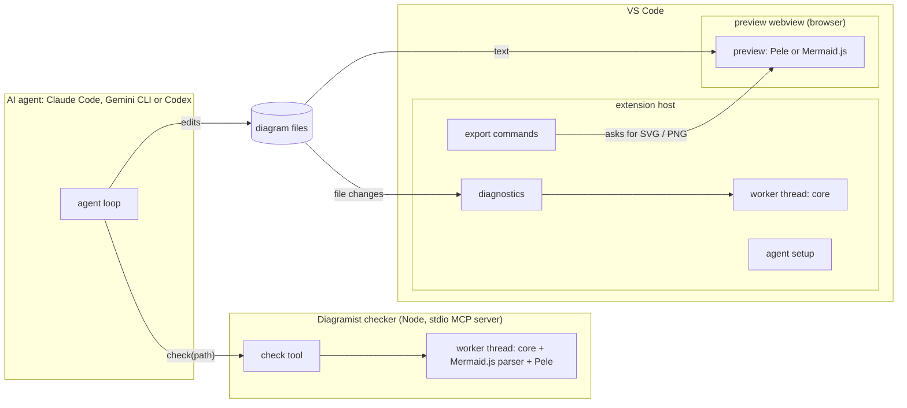

# Diagramist

*   **Author:** Beshoy Sabri
*   **Status:** Draft
*   **Date:** 2026-11-11
*   **Input:** [concepts_brief.md](concepts_brief.md), including its "Decisions after the review"

--------------------------------------------------------------------------------

## Overview

Diagramist helps AI coding agents write Mermaid diagrams that render where they will be used, and
lets the person see and export those diagrams in VS Code. It has three parts that share one core:

1. **Checker.** A small local program that agents start themselves as an MCP server over standard
   input and output (stdio). It may also ship as a command-line tool (open question 7). Given a file,
   it finds every Mermaid diagram in it and checks each one with Mermaid.js (syntax) and Pele (full
   render). For each diagram and each renderer it returns either "OK" or the first error, with the
   error's line and column in the file when the renderer gives one. It needs no VS Code, network,
   account or AI model.
2. **VS Code extension.** It previews diagrams with Pele or Mermaid.js in VS Code's colours and shows
   the same errors in the Problems panel. It exports SVG and PNG for slides and documents, and helps
   connect Claude Code, Gemini CLI and Codex to the checker.
3. **Core.** Shared code with no dependency on VS Code. It holds:
   * finding diagrams in files and mapping positions;
   * one adapter per renderer, which is the only code that imports `mermaid` or `pele`;
   * the result format;
   * the render and security settings;
   * the theme map.

   Both the checker and the extension use the core, so they give the same verdict.

Diagramist calls no AI model. The person's agent writes the diagrams; Diagramist checks, shows and
exports them.

## The Problem

People ask AI coding agents (Claude Code, Gemini CLI, Codex) to draw diagrams as Mermaid text:
architecture sketches in READMEs, flows in documentation, figures for slides. Three things go wrong.

1. **Agents can't see whether a diagram renders.** They write Mermaid from memory, and small slips
   are common: an unclosed bracket, a reserved word, or a newer diagram type the destination doesn't
   support. The agent reports the work as done, and the person finds the problem later:
   * GitHub shows a render error after a push;
   * Notion shows raw code;
   * an exported slide image comes out broken.
2. **The fix loop is manual.** Today the person copies errors from a preview, or from an online
   editor, back into the agent's chat, often several times. Online checkers send the diagram to a
   website, which some workplaces don't allow. Agent-side tools that exist today mostly need a
   headless browser, one specific renderer, or an online service.
3. **Renderers disagree.** GitHub, Notion and documentation sites draw Mermaid with Mermaid.js, each
   with its own version. Pele, Obsidian's renderer, is fast, small and themeable, which suits exported
   images. But its layout differs, and it accepts or rejects some input differently. A test on
   2026-11-11 showed a Sankey value of `abc` passing Mermaid.js and failing Pele. A single "valid"
   verdict hides this.

What exists today (checked 2026-11-11):

* **Preview extensions.** VS Code has Mermaid preview extensions, from the official Mermaid Chart
  extension (Mermaid.js, about 1.18 million installs) to three small Pele-based previews. They show
  diagrams to people, but none offers agents a check they can call.
* **Agent and command-line tools.** npm has two Pele command-line tools and several Mermaid MCP servers
  built on Mermaid.js or other renderers. None of them does all three of:
  * check against both renderers;
  * map errors to positions in the real file;
  * tie into the editor's Problems panel and preview.

## Goals

1. **Agents can check a file without VS Code.** One tool call, given only a path, checks every
   Mermaid diagram in a file, with VS Code closed. For each diagram and renderer the result gives OK,
   or the first error with:
   * the renderer and its version;
   * the error class: invalid diagram, not supported by this renderer, too large, or tool problem;
   * the renderer's error code;
   * the file line and column, when the renderer provides them;
   * a short snippet;
   * a hint.

   *Measure:* a passing file costs under 100 tokens of tool output, and a failing diagram under 1,000
   tokens by default.
2. **Two renderers, one result format.** Every diagram is checked by Mermaid.js (syntax) and by Pele
   (full render). Both versions are pinned and named in every result. The user decides which
   renderers must pass (the "targets"): for example, Mermaid.js for a README that GitHub draws, and
   Pele for a slide image Diagramist exports. A failure in a renderer that isn't a target is a
   warning, not an error.
3. **Tested with three agents.** Setup and the check-and-fix loop are tested and documented for Claude
   Code, Gemini CLI and Codex run from a terminal, including VS Code's integrated terminal. Their own
   VS Code panels are covered where they share the terminal's settings (to verify).

   *Measures:*
   * Connecting one agent takes one command and under two minutes.
   * Before each release, a hand-run test uses a fixed set of at least 30 diagrams with planted
     errors. Each agent must reach a passing diagram within three checks in at least 90% of cases.
4. **Live preview in VS Code.** `.mmd` and `.mermaid` files, and ```` ```mermaid ```` fences in
   Markdown, preview with either renderer in VS Code's theme colours. The preview:
   * updates as you type and when files change on disk;
   * keeps the diagram's written direction;
   * never takes focus when an agent changes a file.

   *Measure:* a Pele preview updates within 300 ms after typing stops, and a Mermaid.js preview
   within 1 second.
5. **Same errors in the editor.** The Problems panel shows the same errors the agent gets, labelled by
   renderer, at the same file positions.
6. **Export for slides and documents.** The user can export a diagram as SVG or PNG and choose:
   * the renderer;
   * the theme: light, dark, or VS Code's current theme;
   * for PNG, the scale.

   Exported files stand on their own: they carry real colours and a fixed font, not VS Code's theme
   colours.
7. **Local and private.** No part of Diagramist makes network requests or calls an AI model.
   Mermaid.js and Pele ship inside Diagramist at pinned versions. Remote images in diagrams are blocked
   by default.

   *Measure:* the test suite passes with networking blocked.
8. **Feature-based code on a shared core.** Code is organized by feature on top of a shared core that
   does not depend on VS Code. Import rules are checked in CI.

## Non-Goals

These are for v1.

*   **Writing diagrams.** There is no prompt box and no AI call. The user's agent writes the diagrams;
    Diagramist checks, shows and exports them.
*   **Matching GitHub's or Notion's exact Mermaid.js version.** Diagramist pins one Mermaid.js version
    and names it in every result.
*   **Drawing with Mermaid.js outside VS Code.** Mermaid.js needs a browser to lay out a diagram. The
    agent's checker checks Mermaid.js syntax but draws only with Pele; Mermaid.js drawings come from
    VS Code's preview pane.
*   **Images for agents to look at.** Results are text. Showing agents rendered images is a possible
    later feature.
*   **Math, icon packs, a Mermaid grammar, auto-completion, Obsidian internal links.**
*   **VS Code for the Web** (vscode.dev, github.dev).
*   **Other diagram languages**, such as PlantUML, D2 and Graphviz.
*   **A local web server, routing between VS Code windows, or agents controlling the preview.**
*   **Changing agents' settings or instruction files without asking.**
*   **Any backend.** Telemetry is open question 6.

## Open Questions

Questions 1–8 (launch, preview surface, targets, Mermaid.js version, export location, telemetry, CLI,
agent guidance) were resolved on 2026-11-11 as decisions D1–D8. See the Technical Plan, section 9.

Unknowns to verify while drafting:

*   **Diagnostics:** does Claude Code's VS Code integration pass VS Code diagnostics to the model? Do
    Gemini CLI's and Codex's?
*   **Agent setup:** the exact `mcp add` commands, scopes and tool pre-approval settings for Gemini CLI
    and Codex.
*   **Agent limits:** each agent's size limit on tool output, and its support for structured results.
*   **Runtime:** can VS Code's own runtime run the checker on machines without Node
    (`ELECTRON_RUN_AS_NODE=1`)?
*   **Browser stand-in:** Mermaid.js in Node works with jsdom. Lighter stand-ins and their sizes are
    untested.
*   **Preview conflicts:** what happens in VS Code's built-in Markdown preview when two extensions
    render the same Mermaid fence?

## Critical User Journeys (CUJs)

### CUJ 1: Claude Code fixes a README diagram before the user sees it

*   **Given**: Diagramist is installed in VS Code and connected to Claude Code. The README targets
    Mermaid.js.
*   **When**: The user asks Claude Code to add an architecture diagram to `README.md`.
*   **Then**:
    *   Claude Code writes the fence and calls the check.
    *   The result reports "Mermaid.js: syntax error at README.md line 42, column 15", with a snippet
        and a hint.
    *   Claude Code fixes the line, checks again, and gets OK from both renderers.
    *   The preview beside the README updates, and the Problems panel shows no Diagramist entries.

### CUJ 2: Gemini CLI checks a diagram with VS Code closed

*   **Given**: Gemini CLI runs in a terminal, VS Code is not running, and the checker is connected at
    user scope.
*   **When**: The user asks Gemini to draw a sequence diagram in `docs/login.mmd`.
*   **Then**: Gemini calls the check by path, fixes the diagram until it passes, and reports the result.
    No network request is made.

### CUJ 3: Codex or CI runs the command-line check (decision D7)

*   **Given**: A repository has diagrams in `docs/`.
*   **When**: Codex runs `diagramist check docs/`, or a pre-commit hook runs it.
*   **Then**: The output lists `file:line:col: renderer: code: message` lines and exits with a non-zero
    code when a target renderer fails.

### CUJ 4: Exporting a diagram for a slide

*   **Given**: A diagram previews correctly.
*   **When**: The user runs "Diagramist: Export" and picks Pele, a light theme, and PNG at 3×.
*   **Then**: A PNG file is written to the chosen folder. It shows the diagram with real colours and
    the bundled font, and looks the same as the preview when pasted into Google Slides.

### CUJ 5: The renderers disagree

*   **Given**: A Sankey diagram has a value written as `abc`, and the file targets Mermaid.js only.
*   **When**: The diagram is checked.
*   **Then**:
    *   The result shows Mermaid.js OK, plus a Pele syntax error marked as a warning, because Pele is
        not a target.
    *   The Problems panel shows a warning, not an error.
    *   The agent is told not to change the diagram for Pele.

### CUJ 6: A diagram from a cloned repository points at a remote image

*   **Given**: A cloned repository has a diagram with an `https` image.
*   **When**: The user opens the preview.
*   **Then**: The preview shows a "remote image blocked" placeholder, and no network request is made.

### CUJ 7: Connecting an agent

*   **Given**: Diagramist and Codex are installed.
*   **When**: The user runs "Diagramist: Connect AI agent" and picks Codex.
*   **Then**:
    *   Diagramist shows the exact command for Codex at user scope, and runs it if the user agrees.
    *   "Diagramist: Check agent setup" then reports Codex as connected and the checker as reachable.

## Technical Plan (Architecture)

This section starts with the parts that don't depend on an open question. Decisions D1–D8 (section
9) are added one at a time as the author makes them.

### 1. Parts and where they run



*Checked on 2026-11-11 with Pele 1.13.0 and Mermaid.js 12.3.0: both accept this diagram.*

Code runs in four places:

*   **Checker.** A Node program that the agent starts and talks to over stdio using MCP. It never
    contacts VS Code.
*   **Extension host.** VS Code's Node process for extensions. It runs diagnostics, export commands and
    agent setup.
*   **Preview webview.** A browser page inside VS Code. It draws diagrams with Pele or Mermaid.js and
    produces the export images.
*   **Worker threads.** In both the checker and the extension host, the core runs in a worker thread
    with a time limit. A slow diagram therefore can't freeze the agent's tool or VS Code.

The agent and VS Code never talk to each other. They meet only through the files: the agent edits a
file, and the extension sees the change and updates its diagnostics and the preview.

### 2. The core

The core is shared code that runs in all four places. It imports nothing from VS Code, nothing that
needs a browser page, and nothing that works only in Node.

| Module | Job |
| --- | --- |
| `blocks` | Finds diagrams. A `.mmd` or `.mermaid` file is one diagram. In Markdown it finds ```` ```mermaid ```` and `~~~mermaid` fences, including fences indented in lists or quotes. It records each block's start line, indentation and quote prefix, handles CRLF line endings, byte-order marks and tabs, and numbers blocks from 1. |
| `positions` | Turns a renderer's position, which counts from the start of the diagram, into a file position: 1-based line and column, with columns in UTF-16 code units. Errors without a position are attached to the block's first line and marked that way. |
| `renderers/mermaid` | The only code that imports `mermaid`. It checks syntax with `mermaid.parse()` and maps `hash.loc` to positions. In the browser it can also draw. |
| `renderers/pele` | The only code that imports `pele`. It checks with `render()` using fixed options, maps `PeleError` to positions, and draws anywhere. |
| `result` | The result format (version 1). It builds results and prints them as short text and as JSON. |
| `policy` | Fixed render and security settings: Pele `images: false` and `autoDirection: false`, a fixed `now` for checks, Mermaid.js `securityLevel: "strict"`, and size limits that can only be lowered. |
| `hints` | One-line hints for each error code. It recognises types neither renderer supports, such as ZenUML, and fence lines pasted in as diagram text. |
| `targets` | Decides which renderers must pass for a block: both by default, or what the block's `%% diagramist: targets=…` comment says (decision D3). |
| `compat` | The table of diagram types with the Mermaid version that introduced each, and the warnings for types newer than the oldest destination (decision D4). |
| `theme` | Maps VS Code theme colours to Pele's `--pele-*` variables and to a Mermaid.js theme, and holds the fixed light and dark export themes. |

Mermaid.js needs a stand-in for the browser when it runs in Node. The Node entry points (the checker
and the extension-host worker) load jsdom before the core's Mermaid.js adapter, so the core itself
has no Node-only imports.

### 3. What a check returns (result format, version 1)

A check takes a file path, or diagram text as a fallback. It reads the saved file, finds its blocks,
and runs both renderers on each block inside the worker.

```text
CheckResult
  schemaVersion: 1
  checker:   { name: "diagramist", version }
  renderers: { mermaid: "12.3.0", pele: "1.13.0" }
  file:      absolute path, as read from disk
  blocks:    list of BlockResult
  summary:   { blocks, errors, warnings }

BlockResult
  index, startLine, endLine     -- 1-based; file lines of the diagram text
  type                          -- e.g. "flowchart", or null
  targets                       -- renderers that must pass (decision D3)
  verdicts: { mermaid: Verdict, pele: Verdict }
  warnings: list of { code, message }   -- e.g. "theme is ignored by Pele"

Verdict
  ok: true
  or ok: false with
    class:    "invalid" | "unsupported" | "too-large" | "tool"
    severity: "error" for a target renderer, "warning" otherwise
    code:     the renderer's own code, e.g. "syntax"
    message:  first line only
    position: { line, column, unit: "utf16" } or null
    snippet:  up to 200 characters: the line before and the reported line
    hint:     one line
    retry:    whether editing the diagram can fix it
```

Agents read the text form first. A passing file takes one line, and each failing block a few lines.
For example:

```text
README.md: 2 diagrams, 1 error (Mermaid.js 12.3.0, Pele 1.13.0)
README.md:42:15 error [Mermaid.js syntax] Expecting 'SQE', got 'NEWLINE'
   41 |   A[Client] --> B[API
   42 |   B --> C[(DB)]
  hint: the "[" opened on line 41 is not closed; errors are often reported one line late.
README.md:88 ok (sequence)
```

Rules:

*   Only renderers that are targets produce errors; the others produce warnings.
*   Each renderer reports its first error per block, because both stop at the first.
*   A check result never contains SVG. Render options and Mermaid `config` are never inputs.
*   `errors` and `warnings` are lists from version 1. Within version 1, fields are only ever added.
*   The classes "unsupported" and "too-large" set `retry: false`, and their hint tells the agent not to
    rewrite the diagram because of them.

The MCP server offers one read-only tool, `check`, marked `readOnlyHint: true`, `idempotentHint: true`
and `openWorldHint: false`. Its description says when to use it: after writing or editing any Mermaid
diagram, call `check` on the file and fix errors until it passes; after three failures on the same
error, stop and ask the user. There is no `export` tool in v1 (decision D5).

### 4. Time limits and load

*   Each check runs in a worker thread with a 2-second limit, which can be configured. On timeout the
    worker is stopped and a fresh one started. The block gets class "tool" and code "timeout".
*   The extension's diagnostics wait for a 400 ms pause in typing. They cover open documents and files
    changed on disk only, and skip files over 1 MB.
*   The preview draws inside the webview. When a diagram breaks, it keeps the last good drawing, dimmed,
    under the error.

### 5. Security and privacy

*   **No network from any part.** The webview's Content Security Policy allows only Diagramist's own
    scripts and styles, and images only from the extension and `data:`. It allows no connections.
    Command links are off.
*   **Images and scripts in diagrams.** Pele images are off by default. Mermaid.js uses
    `securityLevel: "strict"`, which drops click callbacks and cleans labels. Blocked images show a
    placeholder.
*   **Links** open only through VS Code, after the user confirms. Obsidian-style internal links do
    nothing.
*   **Safety settings** (images, link schemes, limits) can be set only at user or machine scope, so a
    cloned repository's workspace settings can't loosen them.
*   **Restricted Mode** (an untrusted folder): preview and diagnostics stay on; images, links and agent
    setup are off.
*   **Logs** include diagram text only at trace level.

### 6. Observability

*   Every result, log line and diagnostic report names the Diagramist, Mermaid.js and Pele versions.
*   The extension uses one VS Code log channel, "Diagramist", which follows VS Code's log level. The
    checker logs to stderr, because MCP uses stdout for protocol messages.
*   A self-test draws one small sample of every supported diagram type with each renderer. It runs on
    first activation and with `--self-test`, so packaging faults show up before an agent meets a false
    error.
*   "Diagramist: Copy diagnostic report" collects versions, settings, agent setup status and recent
    counts. It leaves out diagram text and paths unless the user opts in.

### 7. Code layout (feature-based)

```text
skills/diagramist/SKILL.md   agent guidance (decision D8)
src/
  core/                      shared, runtime-neutral (section 2)
  features/
    checker/     server/     stdio MCP server
    cli/         server/     diagramist check (decision D7)
    diagnostics/ host/       Problems panel
    preview/     host/ webview/
    export/      host/ webview/
    agent-setup/ host/       connect, check and disconnect agents
  platform/
    node/                    worker threads, jsdom loader, file access
    vscode/                  log channel, settings, workspace trust
    browser/                 webview messaging
```

Import rules, checked in CI with dependency-cruiser:

*   `core` imports only itself, plus the two renderers inside `core/renderers/*`.
*   Features import `core` and `platform`, never each other.
*   Code in `webview/` and `server/` never imports code from `host/`.
*   Only `core/renderers/mermaid` imports `mermaid`, and only `core/renderers/pele` imports `pele`.

Each feature exports one `register` function, and the extension's activation calls them in order.

### 8. Choices with one defensible answer (made without a gate)

*   **Build:** TypeScript in strict mode. esbuild builds four bundles: extension host, webview,
    checker and worker.
*   **Runtime:** Node 20 or later, because Pele requires it.
*   **Renderer versions:** `mermaid` and `pele` are pinned to exact versions. Upgrades go only through a
    pull request that runs the regression set (Pele's and Mermaid's examples plus our edge cases) and
    compares verdicts, codes and positions.
*   **IDs:** internal ID and prefix `diagramist` for settings, commands, the MCP server name and the log
    channel.
*   **Tests:**
    *   Vitest for the core and features;
    *   `@vscode/test-electron` for the extension;
    *   MCP contract tests with the official SDK client;
    *   Playwright with a local Chromium for drawing and export in the webview.

### 9. Decisions

| # | Decision | Status |
| --- | --- | --- |
| D1 | How agents start the checker (open question 1) | **decided: A, npm package, installed globally** |
| D2 | Preview surface (open question 2) | **decided: A, Diagramist's own preview panel** |
| D3 | How targets are declared (open question 3) | **decided: A, both by default, comment to opt out** |
| D4 | Mermaid.js version policy (open question 4) | **decided: C, newest version plus warnings for newer types** |
| D5 | Where PNG export runs (open question 5) | **decided: A, from the preview panel only** |
| D6 | Telemetry (open question 6) | **decided: A, none** |
| D7 | CLI in v1 (open question 7) | **decided: A, yes** |
| D8 | Where agent guidance lives (open question 8) | **decided: B, short tool descriptions plus one shared `SKILL.md`** |

#### D1: agents start the checker from an npm package installed globally

*Decided 2026-11-11. The author was shown three options: A, an npm package; B, a launcher inside the
extension; C, both. After asking which one the Elephant would pick, the author took A.*

*   **The package.** The checker is published to npm as `diagramist`. Its command `diagramist` has the
    subcommands `mcp` (the stdio MCP server), `--version` and `--self-test`. Decision D7 decides
    whether it also offers `check` for shells and CI.
*   **How agents run it.** Agent settings run `diagramist mcp` from a global install
    (`npm install -g diagramist`), not `npx`. A test on 2026-11-11 showed that `npx` keeps npm's own
    process running next to the checker, adding about 96 MB for every agent session.
*   **Connecting an agent.** "Diagramist: Connect AI agent" checks for `diagramist` on the PATH. If it
    is missing, it offers to run `npm install -g diagramist@<the extension's version>`, then runs the
    agent's own `mcp add` command at user scope, or shows it for the user to copy.
*   **Versions.** The extension and the npm package are built from the same repository and the same
    version tag. "Check agent setup" warns when the installed checker's version differs from the
    extension's.
*   **When it fails:** without Node, or without access to the npm registry for the one-time install.
    The launcher from option B can be added later without breaking anything, if locked-down networks
    need it.

Resource use, measured on 2026-11-11 (Node 22, resident memory of one process):

| Checker state | Memory |
| --- | --- |
| Started, nothing loaded | about 56 MB |
| Pele loaded, one diagram drawn | about 63 MB |
| Mermaid.js and jsdom loaded, two checks | about 155–159 MB |

So the checker loads Mermaid.js only on the first check that needs it, and not at all when Mermaid.js
is not a target for the file. Each agent session starts its own checker.

In Node, the two renderers must not share browser stand-ins. With jsdom's `window` and `document`
present, Pele assumes it is in a browser and tries jsdom's canvas, which is not implemented (seen in a
test on 2026-11-11). Pele's built-in width table (`metricsMeasurer`) is not part of its public exports.
So Pele and Mermaid.js run in two separate worker threads. The Pele worker has no browser globals, and
the Mermaid.js worker loads jsdom and starts only when a check needs Mermaid.js.

#### D2: one Diagramist preview panel

*Decided 2026-11-11 (options: A, own panel; B, VS Code's built-in Markdown preview; C, both). The
author took A.*

*   **Opening it.** "Diagramist: Open Preview to the Side" appears as a button in the editor title bar
    for `.mmd`, `.mermaid` and Markdown files. Its keybinding is limited to those files, so it never
    replaces Markdown's own preview shortcut.
*   **One panel.** It follows the active editor, with a lock toggle. It shows every diagram in the
    file in order, each labelled with its block number and line, and scrolls to the diagram at the
    cursor.
*   **Renderer switch.** Pele or Mermaid.js, per panel. Both draw in the webview.
*   **Updates.** It redraws from the editor's text after a pause in typing (300 ms for Pele, up to
    1 second for Mermaid.js) and when files change on disk. It never takes focus. When an agent changes
    a file that isn't shown, the status bar says so.
*   **Status line.** It shows the file, block, renderer and its version, the update time, a short
    content hash and the number of warnings.
*   **Theme.** It follows VS Code's light, dark and high-contrast themes. Pele gets them through the
    `--pele-*` to `--vscode-*` map; Mermaid.js gets them as its "base" theme with `themeVariables` built
    from the same colours.
*   **Security.** The strict policy in section 5. Export buttons live in this panel (decision D5).
*   **Accessibility.**
    *   Diagrams can be reached with Tab.
    *   Errors are announced to screen readers and shown as text as well as colour.
    *   Diagram titles and descriptions (`accTitle` and `accDescr`) are kept.
*   **Restoring.** After a reload the panel reopens on the same file and block. It stores only those
    two values, with a version number.
*   **Not in v1:** drawing diagrams inline in VS Code's built-in Markdown preview. It can be added later
    as an opt-in without breaking anything.

#### D3: both renderers must pass unless the diagram opts out

*Decided 2026-11-11. The options were: A, both by default with a comment to opt out; B, A plus a
project file with folder rules; C, defaults by file type plus both overrides. The author took A.*

*   **Default targets:** Mermaid.js and Pele, so a passing diagram works on GitHub and Notion and also
    exports with Pele.
*   **Opting out:** a comment line inside the diagram: `%% diagramist: targets=mermaid`,
    `targets=pele` or `targets=mermaid,pele`. It can be the first line or anywhere in the diagram. A
    test on 2026-11-11 showed both renderers accept the line at the top and after the type line.
*   **Showing the source.** Each block's result shows its targets and where they came from: "default",
    or "comment on line N".
*   **Bad comments.** A comment with unknown values leaves the default in place and adds a warning.
*   **Later, without breaking anything:** a project file with folder rules (option B).

#### D4: the newest Mermaid.js, with warnings for newer diagram types

*Decided 2026-11-11. The options were: A, the newest version only; B, GitHub's version; C, the newest
version plus warnings. The author took C. GitHub does not publish the Mermaid version it runs; its own
docs say to render an `info` diagram to see it.*

*   **The pin.** Diagramist pins the newest Mermaid.js at release time (12.3.0 on 2026-11-11) to an
    exact version. Upgrades go through the regression pull request.
*   **The table.** A small table, `core/compat/mermaid-types.json`, maps each diagram keyword to the
    Mermaid version that introduced it and says whether Pele supports it. It is built once from
    Mermaid's changelog and docs. A CI check fails when the pinned Mermaid.js recognises a keyword the
    table doesn't list, so the table can't fall behind an upgrade.
*   **The oldest destination.** Users can set the oldest Mermaid version they publish to (for example,
    GitHub's). Because D3 means no project file, the setting lives in two places, and "Connect AI agent"
    copies the VS Code setting into the agent's command:
    *   the checker option `--oldest-mermaid <version>`, in the agent's MCP command;
    *   the VS Code setting `diagramist.oldestMermaidVersion`.
*   **Warnings.**
    *   A diagram whose type is newer than the oldest destination gets a warning, for example "venn-beta
        was added in Mermaid 12.0; your oldest destination is 11.4".
    *   Until a version is set, only beta types (keywords ending in `-beta`) are flagged, with the
        warning "beta diagram type; may not render on sites with older Mermaid".
    *   These are always warnings, never errors.

#### D5: export from the preview panel only

*Decided 2026-11-11. The options were: A, the preview panel only; B, the panel plus SVG and PNG from
the checker; C, the panel plus SVG only from the checker. The author took A.*

*   **The command.** "Diagramist: Export Diagram…" runs from a panel button or the command palette. It
    asks for:
    *   the diagram, when the file has several;
    *   the renderer: Pele or Mermaid.js;
    *   the format: SVG or PNG;
    *   the theme: light, dark, or VS Code's current theme;
    *   for PNG, the scale: 1× to 4×, default 2×.

    VS Code's save dialog suggests a name such as `README-2.pele.png`, next to the source file.
*   **SVG.** Colours and fonts are written into the file as plain values, read from the drawn diagram.
    The file therefore doesn't depend on CSS variables, which some slide tools don't support. The font
    is a common stack, such as Helvetica, Arial or sans-serif, that matches the preview.
*   **PNG.** The panel's browser draws the SVG onto a canvas at the chosen scale. Pele's SVG contains
    no `foreignObject` (checked on 2026-11-11), and Mermaid.js exports are drawn with
    `htmlLabels: false`, so the canvas stays readable.
*   **Saving.** The panel sends the bytes to the extension host, which writes the file. The panel itself
    never touches the disk.
*   **Not in v1:** export by agents or scripts. A checker `export` tool (option B, or SVG-only option C)
    can be added later without breaking anything.

#### D6: no telemetry

*Decided 2026-11-11. The options were: A, none; B, opt-in telemetry with no diagram content. The
author took A.*

*   No part of Diagramist sends data anywhere, which keeps Goal 7 without exceptions. The README says
    so.
*   For debugging, the extension and the checker keep local counts:
    *   checks run;
    *   errors by renderer and code;
    *   attempts until the first pass;
    *   repeated identical errors.

    "Diagramist: Copy diagnostic report" includes these counts, and the user decides whether to share
    them in an issue.

#### D7: the command-line checker ships in v1

*Decided 2026-11-11. The options were: A, yes; B, the MCP server only. The author took A.*

*   **Command.** `diagramist check <paths…>` takes files or folders. In folders it checks `.mmd`,
    `.mermaid` and `.md` files and skips `node_modules` and hidden folders.
*   **Output.**
    *   Each problem is one line, `path:line:col: severity [renderer code] message`, followed by the
        indented snippet and hint lines, the same as the text form in section 3.
    *   Passing files are listed only with `--verbose`.
    *   A summary line comes last.
*   **Exit codes:**
    *   0: every target renderer passes;
    *   1: at least one error;
    *   2: a tool or usage problem, such as a missing file or a timeout.
*   **Options:**
    *   `--json` prints one result per file in the section 3 format, one JSON object per line;
    *   `--oldest-mermaid <version>` (D4);
    *   `--verbose`.
*   **Same engine.** The core and worker are shared with the MCP server, so the CLI and the agent tool
    always agree.
*   **Docs** include a pre-commit hook and a CI example.
*   **Stability.** The text output is for people and agents. Scripts should use `--json`, whose fields
    follow the result format's versioning rules.

#### D8: short tool descriptions plus one shared `SKILL.md`

*Decided 2026-11-11. The options were: A, tool descriptions only; B, descriptions plus a shared skill
file; C, a package per agent. The author took B.*

*   **The tool description** for `check` stays under about 80 words, because agents receive it on every
    turn. It says when to call `check`, and when to stop and ask the user.
*   **The skill file.** One file, `skills/diagramist/SKILL.md`, ships in the npm package and the
    extension. Its frontmatter description reads: "Use when writing or editing Mermaid diagrams: check
    them with Diagramist and fix errors before finishing." The body, about 150 lines at most, covers:
    *   when to check: after every change to a diagram;
    *   how to check: the MCP tool `check` with a path, or `diagramist check <path>` in a shell;
    *   how to read results: renderers, error classes, `retry`, warnings, and errors reported one line
        late;
    *   the `%% diagramist: targets=…` comment;
    *   the rule to stop after three failures on the same error;
    *   short tips per diagram type;
    *   what not to do: don't rewrite a diagram for "unsupported" or "too-large" errors, don't add
        `%%{init}%%` theme blocks, and don't use HTML labels.
*   **Installing it.** "Connect AI agent" copies the skill into the chosen agent's user-level skills
    folder, after the user agrees: `~/.claude/skills/diagramist/` for Claude Code, and the documented
    skills folders for Codex and Gemini CLI (to be confirmed in the Detailed Implementation). The
    README shows how to copy it by hand.
*   **Versions.** The skill names the Diagramist version it was written for. "Check agent setup" flags a
    copy that is out of date.
*   **Later, without breaking anything:** per-agent packages (option C).

## Alternatives Considered

The sources are the brief's "Alternatives Weighed", the author's decisions after the review, the
options the author passed over in D1–D8, and the existing tools found on 2026-11-11.

### Alternative 1: A standalone app with its own web UI

*   **Pros**: works from any browser, including a phone, and needs no VS Code.
*   **Cons**: a server to run and secure, a second place to edit diagrams, and it sits away from where
    agents work.
*   **Reason for Rejection**: Rejected by author: they want to work inside VS Code.

### Alternative 2: The extension calls Gemini CLI, or another agent CLI, to write diagrams

*   **Pros**: a prompt box inside VS Code, with no separate agent session.
*   **Cons**:
    *   It ties the tool to one agent.
    *   Starting an agent for each request takes seconds and breaks easily across the agents'
        frequent releases.
    *   It needs that agent's login on the machine.
*   **Reason for Rejection**: Rejected by author: any agent should be able to drive Diagramist, so it
    calls no AI model.

### Alternative 3: Pele only (the shape after the Goldfish review)

*   **Pros**: one renderer, about 7 MB of memory, checks in under a millisecond, and no browser
    stand-in.
*   **Cons**: GitHub, Notion and documentation sites draw with Mermaid.js, so a diagram that passes
    Pele can still fail there.
*   **Reason for Rejection**: Rejected by author on 2026-11-11. The destinations include GitHub, Notion
    and documentation sites, so Diagramist checks and previews with both renderers.

### Alternative 4: The names "Pele Renderer", "Pele Diagrams for VS Code", "Diagramsmith" and "Lavagram"

*   **Pros**: the first two say what the tool is built on, and the last two were free on every registry
    checked.
*   **Cons**: the first two read as official Obsidian products and put third-party names (Pele, VS Code)
    into a permanent ID. With Mermaid.js added, they also describe only half the tool.
*   **Reason for Rejection**: Rejected by author, in favour of "Diagramist".

### Alternative 5: Contribute to an existing Pele preview extension

*   **Pros**: less new code and an existing user base. The candidates were
    `pdanpdan.mermaid-pele-preview`, `bumkom.markdown-viewer-lite` and `saeris.markdown-mermaid-pele`.
*   **Cons**: they are Pele-only previews, a few weeks old, with 42–130 installs each. None has an agent
    checker, Mermaid.js, a CLI or export.
*   **Reason for Rejection**: Not adopted. The author's later decisions (both renderers, an agent
    checker, a CLI, export) go well beyond these previews. The author was not asked about contributing
    upstream as a separate question; it is raised at this section's approval gate.

### Alternative 6: Use an existing Pele CLI (`@ahmedelgabri/pele-cli`, `@simhozebs/pele-cli`)

*   **Pros**: they already check and draw diagrams with Pele.
*   **Cons**: Pele only, no MCP server, no mapping of positions into Markdown files, and no Mermaid.js.
*   **Reason for Rejection**: Not adopted, for the same scope reasons as Alternative 5.

### Alternative 7: Use an existing Mermaid MCP server

*   **Pros**: agents can call them today.
*   **Cons**: Mermaid.js only, with no Pele. Several draw through a headless browser, which is heavy.
    None maps positions into files or ties into the editor.
*   **Reason for Rejection**: Not adopted. They cover neither Pele nor the editor side of the loop.

### Alternative 8: Offer the tools through VS Code's own tool APIs

*   **Pros**: no separate program, and the tools sit next to the preview.
*   **Cons**: `vscode.lm.registerTool` and the MCP server provider API reach only VS Code's built-in chat
    (Copilot), not Claude Code, Gemini CLI or Codex.
*   **Reason for Rejection**: Rejected on technical grounds in the Goldfish review. The same checker
    can still be registered there later as an extra.

### Alternative 9: A local web server inside the extension, linking agents and the preview live

*   **Pros**: agents could drive the preview directly.
*   **Cons**:
    *   It needs a port, a token and protection against web pages calling it.
    *   Every VS Code window runs its own server, so a request can reach the wrong window.
    *   The server disappears when VS Code closes, and it fails in remote setups.
*   **Reason for Rejection**: Rejected by author when accepting the brief's reshaped design on
    2026-11-11.

### Alternative 10: Load Pele or Mermaid.js from a CDN

*   **Pros**: a smaller package.
*   **Cons**: it breaks offline use, needs a looser Content Security Policy, and lets the renderer
    change without a release.
*   **Reason for Rejection**: Rejected on technical grounds in the Goldfish review. It also conflicts
    with Goal 7.

### Alternative 11: Render on the extension host's main thread

*   **Pros**: simpler code.
*   **Cons**: neither renderer has a time limit, so one slow diagram would freeze every extension in the
    window.
*   **Reason for Rejection**: Rejected on technical grounds in the Goldfish review. Pele's own docs
    recommend a worker when a time limit is needed.

### Alternative 12: Check Mermaid.js syntax with `@mermaid-js/parser`, without a browser stand-in

*   **Pros**: no jsdom, so about 100 MB less memory per checker.
*   **Cons**: version 2.0.1 parses only 12 types: architecture, cynefin, eventmodeling, gitGraph, info,
    packet, pie, radar, railroad, treemap, treeView and wardley. It does not parse flowcharts, sequence,
    class, state, ER, Gantt or the other common types (checked on 2026-11-11).
*   **Reason for Rejection**: Rejected on technical grounds: it misses the most-used types. Worth
    revisiting as it grows. It could then replace jsdom one diagram type at a time.

### Alternative 13: Draw with Mermaid.js in the checker through a headless browser

*   **Pros**: Mermaid.js drawings and exports without VS Code.
*   **Cons**: a browser download of hundreds of megabytes, seconds to start, and far more memory.
*   **Reason for Rejection**: Rejected on technical grounds for v1. Mermaid.js drawings come from VS
    Code's panel (decision D5).

### Options passed over in decisions D1–D8

Each row was rejected by the author when making that decision. For D1 the author asked for the
Elephant's pick before choosing.

| Decision | Option not taken | Main drawback | Can it be added later? |
| --- | --- | --- | --- |
| D1 | B: launcher inside the extension | Needs VS Code installed, and is no use for CI | Yes, without breaking anything |
| D1 | C: both npm and launcher | Two install paths and two releases to keep in step | Yes |
| D2 | B: VS Code's built-in Markdown preview | Two surfaces, VS Code's preview security settings, double drawing with other Mermaid extensions | Yes, as an opt-in |
| D2 | C: both | All of B's costs in v1 | Yes |
| D3 | B: project file with folder rules | One more file to document; agents must know it exists | Yes, without breaking anything |
| D3 | C: defaults by file type | Three layers of rules to explain | Possibly |
| D4 | A: newest version only | Misses diagram types that GitHub lacks | Not needed: C includes it |
| D4 | B: GitHub's version | Manual tracking, and more disagreement with Pele | No |
| D5 | B: checker exports SVG and PNG | About 3 MB more, Pele only, and font-measuring work | Yes |
| D5 | C: checker exports SVG only | Google Slides needs PNG | Yes |
| D6 | B: opt-in telemetry | A collection service, a privacy policy, an exception to "no network", and low opt-in | Only by changing Goal 7 |
| D7 | B: MCP server only | No CI or pre-commit use; agents need MCP set up | Not needed |
| D8 | A: tool descriptions only | Too thin, and costs tokens on every turn | Not needed |
| D8 | C: a package per agent | Three package formats to maintain | Yes |

--------------------------------------------------------------------------------

## Non-Functional Requirements

*   **Security and privacy.**
    *   No network access and no AI calls anywhere (Goal 7, D6). Remote images are blocked by default,
        and the webview has a strict Content Security Policy (section 5).
    *   Agents' settings, instruction files and skill folders are changed only after the user agrees,
        and only through the agents' own `mcp add` and `mcp remove` commands or a visible file copy.
    *   Logs and the diagnostic report contain no diagram text or paths unless the user opts in.
*   **Performance and resource use.**
    *   A check of a file with up to 10 diagrams returns within 500 ms once the workers are warm.
    *   The first Mermaid.js check may take up to 2 seconds while the Mermaid.js worker loads.
    *   An idle checker uses about 60 MB. With Mermaid.js loaded it uses about 160 MB (measured on
        2026-11-11).
    *   Preview update times are as in Goal 4.
    *   Tool output stays under 1,000 tokens for a failing diagram and under 100 for a passing file.
*   **Rollout and rollback.**
    *   Odd minor versions are pre-releases on the Marketplace and Open VSX, and use the `next` tag on
        npm. Even minor versions are stable.
    *   The extension, the npm package and the skill share one version number and are released from one
        tag.
    *   Rollback means publishing the previous code as a new patch version. Users can also pin a version
        with `npm install -g diagramist@<version>` and VS Code's "Install Another Version".
    *   Settings are never renamed without keeping the old key readable. Saved panel state carries a
        version number, and unknown versions fall back to defaults.

### Additional Resources

*   Pele: https://pele.run (API, compatibility, theming and security pages) and
    https://github.com/obsidianmd/pele.
*   Mermaid.js: https://mermaid.js.org.
*   MCP TypeScript SDK 2.x: `@modelcontextprotocol/server` and `@modelcontextprotocol/client`.
*   VS Code extension guides: webviews, diagnostics, Workspace Trust, publishing with `vsce` and
    `ovsx`.
*   Agent docs:
    *   Claude Code: `claude mcp add`, skills in `~/.claude/skills/`.
    *   Gemini CLI: `gemini mcp add --scope user`, skills in `~/.gemini/skills/` or
        `~/.agents/skills/`.
    *   Codex: `codex mcp add`, `~/.codex/config.toml`, user skills in `$HOME/.agents/skills`
        (OpenAI's skills page, checked 2026-11-11).
*   EGM: the brainstorm brief, [concepts_brief.md](concepts_brief.md), and Google's Elephant-Goldfish
    Model, pinned commit `e9e1f06`.

### Future Improvements

*   **A launcher inside the extension** (D1 option B), for networks that block npm.
*   **Inline diagrams in VS Code's built-in Markdown preview**, as an opt-in (D2 option C).
*   **A project file with folder rules for targets** (D3 option B).
*   **An `export` tool for agents and scripts** (D5 option B or C).
*   **Per-agent packages:** a Claude Code plugin, a Gemini CLI extension, a Codex plugin (D8 option C).
*   **Replacing jsdom with `@mermaid-js/parser`**, one diagram type at a time, as that parser grows
    (Alternative 12).
*   **Rendered images for agents to look at**, opt-in, for agents that can read images.
*   **Registering the same checker for VS Code's built-in chat** through the MCP server provider API
    (Alternative 8).

--------------------------------------------------------------------------------

## Detailed Implementation Plan

Implementation starts on its own branch (`v0.1`) after `egm-review`. Paths are relative to the
repository root. No step leaves a design decision to the implementer. The one measured choice, which
browser stand-in Mermaid.js uses in Node, comes with a fixed rule in step 0.

### Step 0: Spike to confirm packaging

Before anything else, check that `mermaid` 12.3.0 and the browser stand-in can be bundled by esbuild
into one Node file that passes the Mermaid.js part of the regression corpus.

*   **Candidates:** jsdom 31.0.0 (works in the 2026-11-11 test), then happy-dom and linkedom.
*   **Rule:** choose the smallest bundle that passes every corpus case. If none passes, ship jsdom
    unbundled as a runtime dependency of the npm package, and bundled into the VSIX's `node_modules`.
*   **Record:** the result goes in `docs/designs/diagramist.md` under "Packaging notes".

### Target Files to Create/Modify

#### Repository and build

1.  `package.json` (Create). Private workspace root.
    *   **Scripts:** `build`, `typecheck`, `lint:deps`, `test`, `test:mcp`, `test:extension`,
        `test:webview`, `test:offline`, `package`, `release:check`.
    *   **Runtime libraries, pinned exactly:** `mermaid@12.3.0`, `pele@1.13.0`, `jsdom@31.0.0` (or the
        step 0 winner), `@modelcontextprotocol/server@2.4.0`.
    *   **Development tools:** `typescript@7`, `esbuild@0.28`, `vitest@5`, `dependency-cruiser@18`,
        `@vscode/test-electron@3`, `@vscode/vsce@4`, `ovsx@1`, `playwright-core@1.65`,
        `@modelcontextprotocol/client@2.4.0`, `@types/node@20`, `@types/vscode@1.90`.
    *   **Why `@types/vscode` 1.90:** it keeps the code to APIs that VS Code 1.90 and the forks have.
2.  `package-lock.json` (Create). Lockfile, committed.
3.  `tsconfig.base.json` (Create). Shared settings: strict mode, target ES2022, `noEmit` (esbuild
    compiles).
4.  `tsconfig.core.json` (Create). Covers `src/core/**` with no DOM library and no Node types. The type
    checker itself then stops core code from using browser or Node APIs.
5.  `tsconfig.node.json` (Create). Covers `src/platform/node/**`, `src/platform/vscode/**`,
    `src/features/*/server/**`, `src/features/*/host/**` and `src/extension.ts`, with Node and VS Code
    types.
6.  `tsconfig.webview.json` (Create). Covers `src/platform/browser/**` and `src/features/*/webview/**`,
    with the DOM library and no Node types.
7.  `scripts/build.mjs` (Create). esbuild builds:
    *   `packages/vscode/dist/extension.js` (CommonJS, `vscode` external);
    *   `packages/vscode/dist/webview.js` (browser IIFE, includes Pele and Mermaid.js);
    *   `packages/*/dist/pele-worker.js` and `packages/*/dist/mermaid-worker.js` (Node);
    *   `packages/diagramist/dist/cli.js` (Node, with a shebang).

    It injects the version numbers, copies `skills/` and `LICENSE` into both packages, and fails if
    any two bundles embed different `mermaid` or `pele` versions.
8.  `scripts/sync-version.mjs` (Create). Sets one version in the root, both package manifests and the
    `SKILL.md` frontmatter.
9.  `scripts/third-party-notices.mjs` (Create). Collects the licences of every bundled package into
    `THIRD_PARTY_NOTICES.md` in both packages.
10. `.dependency-cruiser.cjs` (Create). The import rules from Technical Plan section 7, plus "only
    `src/core/renderers/pele/**` imports `pele`" and "only `src/core/renderers/mermaid/**` imports
    `mermaid`".
11. `vitest.config.ts` (Create). Unit test configuration. The coverage threshold is 90% of lines in
    `src/core`.
12. `.gitignore` (Modify). Add `packages/*/dist/`, `coverage/`, `.vscode-test/` and `*.vsix`.
13. `.github/workflows/ci.yml` (Create). On every pull request, on Ubuntu, macOS and Windows:
    install, build, typecheck, `lint:deps` and the tests. The extension tests run under `xvfb` on
    Linux. The offline test runs on Linux inside `unshare -rn`, which has no network. No secrets.
14. `.github/workflows/release.yml` (Create). On a `v*` tag:
    *   build and run all tests;
    *   `npm publish packages/diagramist` (with provenance);
    *   `vsce publish` and `ovsx publish` for `packages/vscode`.

    Secrets: `NPM_TOKEN`, `VSCE_PAT`, `OVSX_PAT`. Odd minor versions publish as pre-releases.

#### Packages (published artifacts)

15. `packages/diagramist/package.json` (Create). The npm package:
    *   `name: diagramist`, `bin: { diagramist: dist/cli.js }`;
    *   `files`: `dist`, `skills`, `LICENSE`, `THIRD_PARTY_NOTICES.md`;
    *   `engines.node >=20`, `license: MIT`;
    *   no runtime dependencies, except jsdom if step 0 requires it.
16. `packages/diagramist/README.md` (Create). Install (`npm install -g diagramist`), `diagramist mcp`,
    `diagramist check`, the link to the agent setup guide, and the statement that it is unofficial.
17. `packages/vscode/package.json` (Create). The VS Code manifest:
    *   **Identity:** `name: diagramist`. `displayName: "Diagramist: Mermaid & Pele diagrams for AI
        agents"`. `publisher`: the author's Marketplace publisher ID, to be created by the author.
    *   **Compatibility:** `engines.vscode: ^1.90.0`, `extensionKind: ["workspace"]`.
    *   **Activation:** on `onLanguage:markdown` and `onLanguage:mermaid`, on its commands, and on
        `onWebviewPanel:diagramist.preview`.
    *   **Commands:** `diagramist.openPreviewToSide`, `diagramist.exportDiagram`,
        `diagramist.connectAgent`, `diagramist.checkAgentSetup`, `diagramist.disconnectAgent`,
        `diagramist.copyDiagnosticReport`.
    *   **Menus and keys:** an editor-title button for `.mmd`, `.mermaid` and Markdown files, and a
        keybinding limited to those files.
    *   **Language:** a `languages` entry for ID `mermaid` covering `.mmd` and `.mermaid`, with no
        grammar.
    *   **Settings:**
        *   `diagramist.oldestMermaidVersion`;
        *   `diagramist.preview.defaultRenderer` (`pele` or `mermaid`);
        *   `diagramist.preview.autoDirection` (default `false`);
        *   `diagramist.diagnostics.enabled`;
        *   `diagramist.checkTimeoutMs` (default 2000);
        *   at machine scope only: `diagramist.security.allowImages` (default `false`),
            `diagramist.security.linkSchemes` and `diagramist.limits.*`.
    *   **Restricted Mode:** `capabilities.untrustedWorkspaces` is `limited`, and the security
        settings are restricted.
18. `packages/vscode/README.md` (Create). The Marketplace page. Its first line names Mermaid. It covers
    the preview, the Problems panel, export, connecting agents and the privacy statement, and says the
    extension is unofficial and not affiliated with Obsidian, the Mermaid project or Microsoft.
19. `packages/vscode/.vscodeignore` (Create). Ships only `dist/`, `skills/`, the README, `LICENSE`,
    `THIRD_PARTY_NOTICES.md` and the icon.
20. `packages/vscode/icon.png` (Create). A 128×128 icon.

#### Agent guidance

21. `skills/diagramist/SKILL.md` (Create). The shared skill from D8. Its frontmatter `name` is
    `diagramist`; its description, body and length are as in D8. It lists the version it was written
    for.

#### Core (`src/core`, runtime-neutral)

22. `src/core/blocks/find-blocks.ts` (Create). API: `findBlocks(text, fileKind) -> Block[]` and
    `fileKindFromPath(path)`.
    *   `Block` holds `index`, `contentStartLine`, `endLine`, `indent`, `quotePrefix`, `fence`, and the
        normalized `text`: LF line endings, no BOM, prefixes removed.
    *   A `.mmd` or `.mermaid` file is one block.
23. `src/core/positions/map-position.ts` (Create). API: `toFilePosition(block, pos) -> FilePosition
    | null`.
    *   It adds back the block's line offset, indent and quote prefix. Columns are UTF-16 code units,
        1-based.
    *   A `null` position anchors the error to `contentStartLine`, with `hasPosition: false`.
24. `src/core/renderers/types.ts` (Create). The `RendererAdapter` interface: `id`, `version`,
    `detectType(text)` and `check(text, policy) -> RawVerdict`. `RawVerdict` holds `ok`, `code`,
    `message`, `pos`, `spanStart`, `type` and `classHint`.
25. `src/core/renderers/pele/pele-adapter.ts` (Create). The only importer of `pele`.
    *   It calls `render(text, options)` with options from `policy`.
    *   It maps `PeleError`: `syntax` and `semantic` become "invalid", `unsupported-diagram` becomes
        "unsupported", and `limit` becomes "too-large". Any other exception becomes "tool". Line and
        column 0 mean no position.
    *   It uses only Pele's public API.
26. `src/core/renderers/mermaid/mermaid-adapter.ts` (Create). The only importer of `mermaid`.
    *   It runs `initialize({ startOnLoad: false, securityLevel: "strict" })`, then `parse(text)`.
    *   The error position is `hash.loc.last_line` with column `last_column + 1`. `spanStart` is
        `first_line`, `first_column + 1`.
    *   "No diagram type detected" becomes "unsupported".
    *   In the browser it also exposes `draw(id, text, theme)` through `mermaid.render`, with
        `htmlLabels: false` for exports.
27. `src/core/result/schema.ts` (Create). The types for result format version 1 (Technical Plan
    section 3), plus a JSON Schema for the MCP output schema. Input schemas are flat: strings, numbers
    and booleans, with no `oneOf`, `anyOf` or `$ref`.
28. `src/core/result/build-result.ts` (Create). Combines blocks, targets, verdicts and warnings into a
    `CheckResult`. It sets severity (error for targets, warning otherwise) and the summary.
29. `src/core/result/format-text.ts` (Create). The text form: one header line, then for each problem
    `path:line:col`, the severity, the renderer and code, the message, the previous and reported lines,
    and the hint. It caps output at about 4,000 characters for failures, noting how many were left
    out, and returns one line for a passing file.
30. `src/core/policy/policy.ts` (Create). The fixed render and security options:
    *   Pele: `images: false`, `autoDirection: false` and `responsive: false` for checks; the default
        limits, which settings can only lower.
    *   Mermaid.js: `securityLevel: "strict"`.
    *   A fixed `now` for Gantt checks: 2000-01-01 UTC.
31. `src/core/hints/hints.ts` (Create). One-line hints for each renderer code and class, plus
    detection of:
    *   pasted fence lines, which are stripped and reported;
    *   types neither renderer supports (`zenuml`), reported as unsupported with `retry: false`;
    *   the "reported one line late" pattern, where the previous line has an unclosed bracket or quote.
32. `src/core/targets/targets.ts` (Create). Parses `%% diagramist: targets=…` (D3). It returns the
    targets and their source ("default" or "comment on line N"), and a warning for unknown values.
33. `src/core/compat/mermaid-types.json` (Create). Each diagram keyword with `introducedIn`, `beta`
    and `pele`. It is built once from Mermaid's changelog and docs, as in D4.
34. `src/core/compat/compat.ts` (Create). The warnings for types newer than `oldestMermaidVersion`,
    and the beta-type warning when no version is set (D4).
35. `src/core/theme/theme-map.ts` (Create). The map from `--vscode-*` to `--pele-*`, including the
    high-contrast fallbacks, a Mermaid.js `themeVariables` builder, and the fixed light and dark export
    themes.
36. `src/core/samples/samples.ts` (Create). One minimal valid diagram per supported type, used by the
    self-test and the regression corpus.
37. `src/core/check/check-text.ts` (Create). API: `checkText(text, fileKind, options, renderers) ->
    CheckResult`. It is pure, with the renderers injected, and works with one renderer or both,
    depending on targets.
38. `src/core/version.ts` (Create). Exposes the Diagramist, Mermaid.js and Pele versions injected at
    build time.
39. `src/core/index.ts` (Create). The public API of the core.

#### Platform

40. `src/platform/node/worker-pool.ts` (Create). Two workers: Pele, started at the first check, and
    Mermaid.js, started at the first check whose targets include Mermaid.js.
    *   Each request has a timeout (`checkTimeoutMs`). On timeout the worker is terminated and
        restarted, and the result is class "tool", code "timeout".
    *   The queue holds at most 8 requests, and a newer request for the same file drops the older one.
41. `src/platform/node/pele-worker-entry.ts` (Create). The Pele worker: no browser globals; it runs
    the Pele adapter.
42. `src/platform/node/mermaid-worker-entry.ts` (Create). The Mermaid.js worker: it loads the step 0
    browser stand-in, installs only the globals Mermaid.js needs, and runs the Mermaid.js adapter.
43. `src/platform/node/read-file.ts` (Create). Resolves an absolute, normalized path and reads it,
    refusing files over 1 MB and non-text files.
44. `src/platform/node/logger.ts` (Create). Logs to stderr with levels. It never writes to stdout,
    which MCP owns.
45. `src/platform/vscode/log.ts` (Create). The `LogOutputChannel` named "Diagramist", which follows
    VS Code's log level and logs diagram text only at trace.
46. `src/platform/vscode/settings.ts` (Create). Typed setting access. It ignores workspace values for
    machine-scope security settings.
47. `src/platform/vscode/trust.ts` (Create). Workspace Trust checks for features that are off in
    Restricted Mode.
48. `src/platform/browser/messaging.ts` (Create). Versioned message types between the host and the
    webview: `render`, `status`, `export-request` and `export-bytes`.

#### Features

49. `src/features/checker/server/mcp-server.ts` (Create). Builds the MCP server with
    `@modelcontextprotocol/server`.
    *   It offers one tool, `check`, with inputs `path`, `text`, `block` and `oldestMermaid` (all
        optional, at least one of `path` and `text`).
    *   It returns structured content against the version 1 output schema, plus the text form.
    *   Annotations: `readOnlyHint`, `idempotentHint`, and `openWorldHint: false`.
    *   It uses the stdio transport, and exits when stdin closes or the parent process exits.
50. `src/features/checker/server/tool-description.ts` (Create). The `check` description, at most
    about 80 words. A test enforces the limit.
51. `src/features/cli/server/cli.ts` (Create). Uses `node:util` `parseArgs`.
    *   **Subcommands:** `mcp`, `check <paths…>` (with `--json`, `--oldest-mermaid` and `--verbose`),
        `--self-test`, `--version` and `--help`.
    *   **Exit codes:** 0, 1 and 2, as in D7.
    *   **Folder scans:** `.mmd`, `.mermaid` and `.md` files, skipping `node_modules` and hidden folders.
52. `src/features/cli/server/self-test.ts` (Create). Checks every sample with both renderers, and
    prints and returns the failures.
53. `src/features/diagnostics/host/diagnostics.ts` (Create). A `DiagnosticCollection` named
    "diagramist".
    *   **When it checks:** on open, on change (after 400 ms), on save, and when the file watcher sees a
        change on disk. Open documents only, files up to 1 MB.
    *   **What it shows:** source "Diagramist (Mermaid.js)" or "Diagramist (Pele)", with the renderer
        code as the diagnostic code. Warnings appear as Warning severity.
    *   It clears the entries when a file closes or the problem is fixed.
54. `src/features/preview/host/preview-panel.ts` (Create). One panel, `diagramist.preview`.
    *   It follows the active editor, with a lock, and has a `WebviewPanelSerializer` that restores
        `{ uri, block, v: 1 }`.
    *   It sends block texts, the renderer, the theme and the policy to the webview, and updates the
        status bar when an agent changes a file that isn't shown.
55. `src/features/preview/host/html.ts` (Create). The webview HTML. The CSP is `default-src 'none'`,
    with scripts and styles from the extension's own resources plus a nonce, and `img-src` limited to
    the extension and `data:`. Command links are off.
56. `src/features/preview/webview/main.ts` (Create).
    *   **Drawing:** each block with Pele `mount` (`autoDirection` off, `images` off) or with Mermaid.js
        `draw`, waiting for typing to pause.
    *   **Errors:** shown as text, with the last good drawing dimmed underneath. Errors are announced
        through an `aria-live` region.
    *   **Controls:** the renderer switch, the status line and scrolling to the block at the cursor.
    *   **Keyboard and links:** diagrams can be reached with Tab. Link clicks go to the host, which asks
        before opening.
57. `src/features/preview/webview/styles.css` (Create). The layout, the `--pele-*` variables set from
    the `--vscode-*` variables (from the theme map), high-contrast borders and the error colour.
58. `src/features/export/host/export-command.ts` (Create). "Diagramist: Export Diagram…".
    *   It asks, through quick picks, for the block, renderer, format, theme and PNG scale (D5).
    *   It suggests a file name in VS Code's save dialog.
    *   It asks the webview for the bytes and writes them with `workspace.fs`.
59. `src/features/export/webview/export.ts` (Create).
    *   **SVG:** the colours and fonts read from the drawn diagram are written into the SVG, with no
        `var(--pele-…)` left.
    *   **PNG:** the SVG is drawn onto a canvas at the chosen scale; Mermaid.js drawings use
        `htmlLabels: false`.
    *   The bytes are sent back to the host.
60. `src/features/agent-setup/host/agents.ts` (Create). Data for the three agents:
    *   **Add commands:**
        *   `claude mcp add --scope user diagramist -- diagramist mcp`
        *   `gemini mcp add --scope user diagramist diagramist mcp`
        *   `codex mcp add diagramist -- diagramist mcp`
    *   **Remove commands:** the matching `mcp remove` command for each agent.
    *   **Config files, read only when checking setup:** `~/.claude.json`, `~/.gemini/settings.json` and
        `~/.codex/config.toml`.
    *   **Skill folders:** `~/.claude/skills/diagramist/` for Claude Code, and `~/.agents/skills/diagramist/`
        for Codex (official) and Gemini CLI (its documented alias for the shared folder).
61. `src/features/agent-setup/host/connect.ts` (Create). "Diagramist: Connect AI agent".
    *   **Install:** if `diagramist` is not on the PATH, it offers to run `npm install -g
        diagramist@<extension version>` in a visible terminal.
    *   **Register:** it shows the agent's add command, with `--oldest-mermaid` when that setting is
        set, and runs it in a visible terminal after the user agrees. Otherwise it copies the command.
    *   **Skill:** it copies `SKILL.md` into the agent's skill folder after the user agrees.
62. `src/features/agent-setup/host/check-setup.ts` (Create). "Diagramist: Check agent setup". For each
    agent it reports:
    *   whether the CLI is installed;
    *   whether `diagramist` is registered, read from the agent's config file without editing it;
    *   whether the checker's version matches the extension's (`diagramist --version`);
    *   whether the skill copy is present and its version.
63. `src/features/agent-setup/host/disconnect.ts` (Create). "Diagramist: Disconnect agent". It runs the
    agent's remove command, and deletes the copied skill folder, after the user agrees.
64. `src/features/diagnostic-report/host/report.ts` (Create). "Diagramist: Copy diagnostic report".
    *   It covers versions, VS Code version and kind, OS, settings, agent setup status and the
        session's counts (D6).
    *   Paths and diagram text are left out unless the user ticks to include them.
    *   Counts live in memory only.
65. `src/extension.ts` (Create). `activate` calls each feature's `register` in this order:
    diagnostics, preview, export, agent setup, diagnostic report. It also runs the self-test once per
    version, logging the results. `deactivate` disposes the workers.

#### Tests

66. `test/fixtures/corpus/` (Create). The regression corpus:
    *   one sample per type;
    *   Pele's and Mermaid's documentation examples, with their licences noted;
    *   edge cases: fences at line 40, inside list items and inside quotes; `~~~` fences; CRLF; BOM;
        tabs; emoji before an error; several blocks in one file; frontmatter; the Sankey `abc` value;
        ZenUML; pasted fence lines; a Gantt chart with an invalid date; 50,001 characters.

    It includes the expected verdicts, codes and positions for both renderers.
67. `test/fixtures/agent-eval/` (Create). The 30 or more diagrams with planted errors for the hand-run
    agent check (Goal 3), with a results template.
68. `test/core/*.test.ts` (Create). Unit tests for `find-blocks`, `map-position`, both adapters,
    `targets`, `compat`, `build-result`, `format-text` (including the size cap) and `hints`, driven by
    the corpus.
69. `test/checker/mcp-contract.test.ts` (Create). Starts `dist/cli.js mcp` and connects with
    `@modelcontextprotocol/client` over stdio. It checks:
    *   the handshake;
    *   `tools/list`: the name, the annotations, flat input schemas and the description limit;
    *   `tools/call` on the corpus, for both text and structured results;
    *   a timeout with a 50 ms limit;
    *   that stdout carries only protocol messages.
70. `test/cli/cli.test.ts` (Create). Exit codes, line format, `--json` lines, folder scanning and
    `--self-test`.
71. `test/extension/runTest.ts` and `test/extension/suite/*.test.ts` (Create). With
    `@vscode/test-electron`, they check:
    *   activation;
    *   diagnostics for a broken fence, and clearing them after the fix;
    *   that the preview opens and follows the editor;
    *   that the commands are registered;
    *   Restricted Mode behaviour;
    *   that machine-scope settings ignore workspace values.
72. `test/webview/render.spec.ts` (Create). With Playwright and a local Chromium, against the webview
    bundle, it checks:
    *   both renderers draw the samples;
    *   a remote image makes no request and shows a placeholder;
    *   PNG export has the expected pixel size at 2×;
    *   exported SVG contains no `var(--pele`.
73. `test/offline/offline.test.ts` (Create). Runs `diagramist check` on the corpus inside a network
    namespace with no network (Linux only), and expects the same results.

#### Documentation

74. `README.md` (Modify). Replaces the design-phase text with:
    *   what Diagramist is, and its privacy statement;
    *   install steps for the extension and the npm package;
    *   connecting agents;
    *   the CLI;
    *   the `targets` comment and `oldestMermaidVersion`;
    *   export;
    *   troubleshooting;
    *   that it is unofficial.
75. `docs/agents.md` (Create). Setup, pre-approving the read-only `check` tool, skill folders and
    troubleshooting, for each agent: Claude Code, Gemini CLI and Codex.
76. `docs/ci.md` (Create). A pre-commit hook and a GitHub Actions example using `diagramist check`.
77. `CONTRIBUTING.md` (Create). The folder map, import rules, test commands, the renderer upgrade
    procedure (regression corpus, "Validator changes" in the changelog) and the release steps.
78. `SECURITY.md` (Create). How to report problems privately. It says Pele issues go to
    obsidianmd/pele and Mermaid.js issues to mermaid-js/mermaid.
79. `CHANGELOG.md` (Create). One section per version, including a "Validator changes" heading
    whenever a renderer upgrade changes any verdict.
80. `.github/ISSUE_TEMPLATE/bug_report.md` (Create). It asks for the diagnostic report, and sends
    renderer differences upstream.
81. `docs/designs/diagramist.md` (Create at finalization). The final copy of this design.

### Verification Plan

*   **Build:** `npm run build`. It fails if bundles embed different renderer versions.
*   **Type checks:** `npm run typecheck`, which runs `tsc --noEmit` for the core, Node and webview
    configs.
*   **Import rules:** `npm run lint:deps` (dependency-cruiser).
*   **Unit tests:** `npm test` (Vitest), with at least 90% line coverage in `src/core`.
*   **MCP contract:** `npm run test:mcp`.
*   **Extension:** `npm run test:extension` (`xvfb-run` on Linux).
*   **Webview and export:** `npm run test:webview` (Playwright with Chromium).
*   **Offline:** `npm run test:offline` (Linux).
*   **Packaging:** `npm run package` builds the VSIX and runs `npm pack --dry-run`. Both sizes are
    recorded in the CI summary, and the build fails above 15 MB.
*   **Before each release, by hand:** the agent check from Goal 3, with the results recorded in
    `test/fixtures/agent-eval/`.
*   **Owed by the author before the first release:**
    *   a Marketplace publisher ID and an Open VSX namespace;
    *   an npm account that can publish `diagramist` (the name was free on 2026-11-11);
    *   the three release tokens as repository secrets.

*Drafted with EGM*
